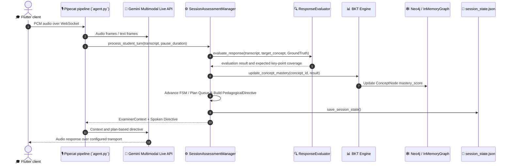
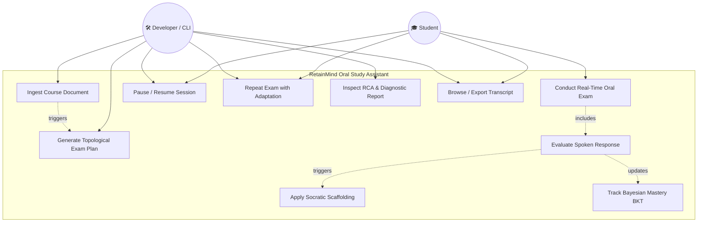
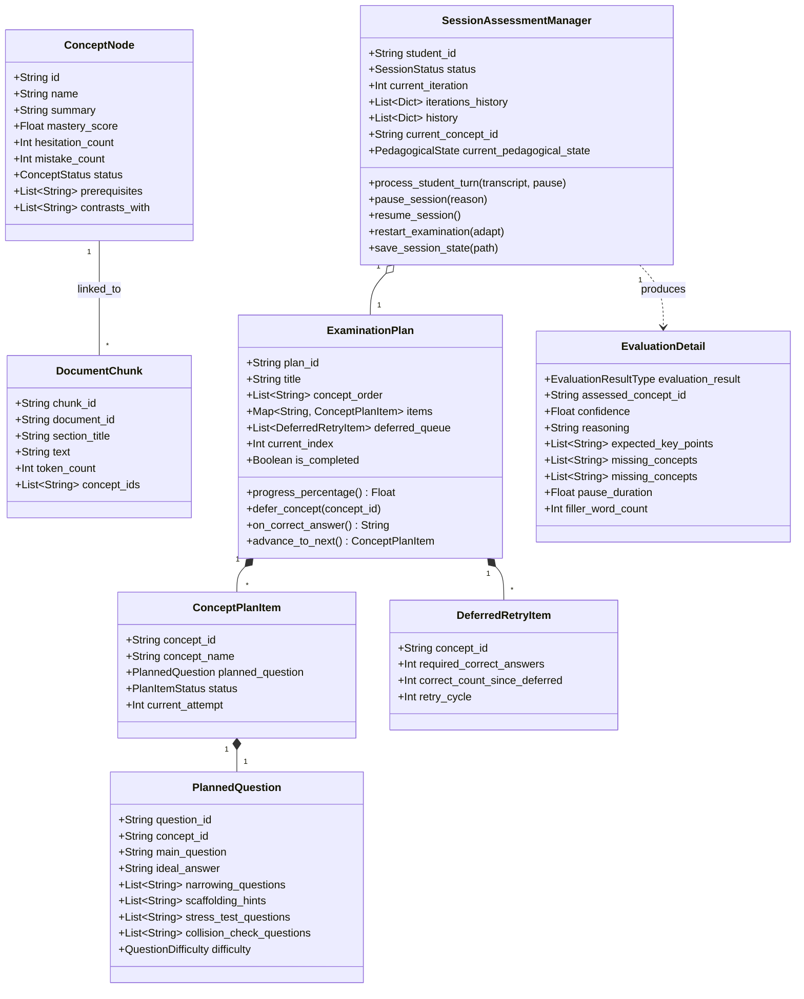
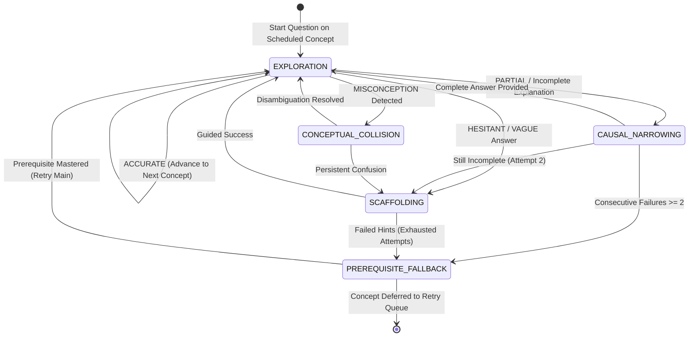

# Requirements Analysis Document (RAD) — RetainMind

**Document Title:** Requirements Analysis Document (RAD) for RetainMind Oral Study Assistant
**Project Name:** RetainMind
**Document Identifier:** RM-RAD-2026-V2.0
**Current Milestone:** Flutter + FastAPI/Pipecat Architecture v3.0
**Compliance Standards:** IEEE Std 830-1998 / ISO/IEC/IEEE 29148:2018
**Author:** RetainMind Engineering Team

---

# 1. Introduction

## 1.1 Purpose of the system

The purpose of **RetainMind** is to deliver an AI-native, voice-first oral examination and continuous assessment assistant for university and higher-education students in cognitively demanding, high-density academic disciplines (e.g., Computer Science, Medicine, Law, Engineering, and Physics).

Traditional computer-assisted learning tools rely predominantly on passive multiple-choice quizzes or static text flashcards (e.g., Anki, SuperMemo). While effective for memorizing atomic facts, such tools fail to prepare students for the systemic rigors of formal oral examinations, which require articulate verbal explanations, multi-hop reasoning, causal attribution, and rapid real-time defense of conceptual arguments.

RetainMind addresses this pedagogical gap by functioning as an **Autonomous Socratic Oral Examiner**. The system ingests authentic course materials (PDF textbooks, lecture slides, Markdown notes), constructs an ontological knowledge graph and dense vector index, derives a topologically structured examination plan, and conducts a bidirectional, full-duplex spoken interrogation session. During the interrogation, the system compares transcribed answers with expected key points, updates BKT estimates, and uses the active plan to guide follow-up questions and summarize progress.

---

## 1.2 Scope of the system

### 1.2.1 In-Scope Capabilities (Current & Proposed)

* **Document Ingestion & Extraction:** Automated text extraction and chunking for supported PDF, Markdown, and TXT materials. OCR support for scanned PDFs is not documented as an active capability.
* **Ontological Graph & Vector Indexing:** Extraction of `ConceptNode` entities, directed relationships (`REQUIRES`, `CAUSES`, `CONTRASTS_WITH`, `EXPANDS`), and text chunks stored in dual databases (**Neo4j** for graph topology and **Qdrant** for dense vector embeddings), with in-memory stores used by the current default setup.
* **Topological Examination Planning:** Automated derivation of structured `ExaminationPlan` objects with pre-calculated question blueprints (main Socratic inquiry, narrowing probes, scaffolding hints, collision checks) ordered by topological prerequisite dependencies.
* **Pipecat Voice Agent:** Real-time oral examination served by FastAPI over Flutter PCM WebSocket or optional SmallWebRTC signaling. Gemini Live is the default voice mode (`gemini-3.8-live`, voice `Aoede`); cascaded STT → LLM → TTS is optional.
* **Cascaded Voice Pipeline (Default):** Modular streaming Speech-to-Text, LLM reasoning, and Text-to-Speech, configured through `AGENT_STT_MODEL`, `AGENT_LLM_MODEL`, and `AGENT_TTS_MODEL` with provider credentials.
* **Plan-Based Response Evaluation:** Transcript answers are compared with expected key points in the plan; the evaluator uses lexical/stem heuristics and response categories. It does not claim to provide validated acoustic or semantic biomarker measurements.
* **Bayesian Knowledge Tracing (BKT) & Pedagogical FSM:** Real-time tracking of latent concept mastery probabilities, driving a pedagogical Finite State Machine with dynamic states (`EXPLORATION`, `CAUSAL_NARROWING`, `SCAFFOLDING`, `CONCEPTUAL_COLLISION`, `PREREQUISITE_FALLBACK`).
* **Deferred Retry Queue:** Concepts can be revisited during the examination; ordering and retry behavior follow the current examination plan and assessment state.
* **Session Lifecycle, Longitudinal Analytics & Persistence:** Mid-exam pausing, seamless resumption, multi-iteration retakes with dynamic pedagogical recalibration, $\Delta\text{Mastery}$ delta tracking, prerequisite Root Cause Analysis, complete turn-by-turn conversation logging, and CLI management.

### 1.2.2 Out-of-Scope Capabilities (Explicitly Excluded / Deprecated)

* **Legacy E-Commerce & User Profile Management:** All legacy modules regarding shopping carts, orders, product catalogs, customer profiles, and general-purpose CRUD operations have been permanently excised from the codebase.
* **Third-Party LMS Synchronizers (Canvas/Moodle/Blackboard):** Direct automated synchronization with proprietary university gradebooks is excluded from the current release.
* **Synchronous Multi-Student Group Oral Exams:** The system is exclusively scoped for 1-on-1 student-examiner interactions.

---

## 1.3 Objectives and success criteria of the project

### 1.3.1 Primary Technical Objectives

1. **Sub-Second Voice Turnaround:** Measure and reduce end-to-end voice latency for the configured Pipecat pipeline across supported client transports.
2. **Context-Grounding Fidelity:** Ground questions in the active plan and retrieved material where available; measure factual accuracy through evaluation.
3. **Dynamic Pedagogical Scaffolding:** Use plan-based follow-up questions for incomplete answers where the plan provides suitable prompts.
4. **State Persistence Integrity:** Preserve session progress through the save and resume paths currently provided by the service.

### 1.3.2 Measurable Success Criteria

| Criterion ID | Metric / Target | Verification Method |
| :--- | :--- | :--- |
| **SC-01** | Reliable behavior across assessment, planning, ingestion, and audio transport | Focused unit and integration tests; no coverage percentage is currently asserted |
| **SC-02** | Audio playback and interruption behavior are usable across supported devices | Manual device checks plus transport and serializer tests |
| **SC-03** | Assessment state transitions follow configured rules | Focused tests for session and FSM transitions |
| **SC-04** | Session state can be resumed from saved session and plan data | Session lifecycle and restart tests |
| **SC-05** | Session history and comparisons produce internally consistent results | Assessment service and report checks |

---

## 1.4 Definitions, acronyms, and abbreviations

| Term / Acronym | Definition |
| :--- | :--- |

| **BKT** | Bayesian Knowledge Tracing — a probabilistic graphical model estimating latent student concept mastery $P(L_t)$. |
| **CCS** | Causal Coherence Score — structural metric evaluating the logical and causal validity of an explanation. |
| **DAG** | Directed Acyclic Graph — topological representation of course concepts and prerequisite dependencies. |
| **Hesitation cue** | Heuristic based on transcript fillers and available pause duration. |
| **FSM** | Finite State Machine — mathematical model governing examiner pedagogical dialogue states. |
| **GraphRAG** | Hybrid Retrieval-Augmented Generation combining ontological graph traversals with dense vector similarity search. |
| **Ground Truth** | Verbatim reference excerpts extracted from ingested course literature used to validate student claims. |
| **Pipecat** | Python framework for composing real-time audio and conversational pipelines. |
| **WebSocket PCM** | Client-server transport carrying mono PCM audio frames encoded in the Flutter protocol. |
| **RCA** | Root Cause Analysis — algorithm identifying deep-seated prerequisite failures underlying higher-level concept errors. |

| **Cascaded pipeline** | Sequential speech-to-text, language-model, and text-to-speech processing. |
| **Scaffolding** | Pedagogical technique offering guided hints and sub-questions to help a struggling student deduce the correct answer. |
| **STT / TTS** | Speech-to-Text (Transcription) / Text-to-Speech (Synthesis). |


---

## 1.5 References

1. **Original Specification:** `RetainMind_Technical_RAG_Specification.md` (Initial Conceptual Blueprint).
2. **IEEE Std 830-1998:** IEEE Recommended Practice for Software Requirements Specifications.
3. **ISO/IEC/IEEE 29148:2018:** Systems and software engineering — Life cycle processes — Requirements engineering.
4. **Pipecat:** Voice pipeline and transport implementation used by the backend.
5. **Google Gemini Live API:** Default native audio pipeline configured by `GEMINI_LIVE_MODEL`; cascaded processing is optional.
6. **Bayesian Knowledge Tracing Formulation:** Corbett, A. T., & Anderson, J. R. (1994). *Knowledge tracing: Modeling the acquisition of procedural knowledge.* User Modeling and User-Adapted Interaction.

---

## 1.6 Overview

This RAD is organized into the following major chapters:
* **Section 2 (Current System):** Documents the exact architecture, components, data flows, storage layers, audio pipelines, and configuration options implemented in the codebase today.
* **Section 3 (Proposed System):** Details the target system evolution, structured Functional Requirements (FR-001 through FR-015), Non-Functional Requirements (NFRs), System Scenarios, Use Case Models, Object Models, Dynamic Models, and UI Wireframes.
* **Section 4 (Glossary):** Comprehensive technical lexicon.
* **Section 5 (Architecture Evolution & Trade-offs):** Retrospective analysis of architectural shifts, abandoned prototypes, and technical justifications.
* **Section 6 (Configuration Matrix):** Detailed breakdown of all environment and runtime variables.

---

# 2. Current System

## 2.1 Current Architecture Overview

The Flutter app offers topic-based plan generation with configurable study level and duration, then lets the student review the generated handout and concepts before beginning the oral exam. The default plan-generation model is `gemini-3.5-flash-lite`.

The current system uses a Flutter client and a Python FastAPI backend managed with `uv`. FastAPI serves REST endpoints and Pipecat voice sessions. Flutter streams mono PCM over WebSocket; SmallWebRTC signaling is also available. The default voice pipeline is Gemini Live; cascaded STT → LLM → TTS is selectable through configuration.

```text
Flutter client (lib/)
  ├─ REST: courses, plans, session status/transcript/control, reports
  └─ WebSocket PCM (mono, 16 kHz input) ──┐
                                           ▼
FastAPI server (backend/src/api.py, port 8000)
  ├─ /ws, /ws/{course_id}, /ws/test/{course_id}
  ├─ SmallWebRTC signaling endpoints (/api/offer, /api/session/webrtc)
  └─ Pipecat pipeline (backend/src/agent.py)
       ├─ default: Gemini Live (`gemini-3.8-live`, 24 kHz output)
       └─ optional: cascaded STT → LLM → TTS
             │
             ├─ SessionAssessmentManager / plan-based evaluation / BKT / FSM
             └─ Per-course graph and vector stores; saved plan and session files
```

---

## 2.2 Main Components and Responsibilities

### 2.2.1 Ingestion & Document Processing Subsystem (`src/rag/ingestion/`)
* **`PdfDocumentParser`:** Extracts raw text, structured tables, and page metadata from PDF documents using `pypdf`.
* **`TextDocumentParser` / `MarkdownDocumentParser`:** Parses plain text and Markdown course summaries preserving section header hierarchies.
* **`DocumentChunker`:** Implements token-aware sliding window semantic chunking (default: 400 tokens with 80-token overlap) creating `DocumentChunk` entities.
* **`ConceptExtractor`:** Uses the configured extraction model (default `gemini-3.5-flash-lite`) with structured output validation to extract `ConceptNode` entities, prerequisite relations, causal chains, and summary definitions directly from text chunks.
* **`IngestionPipeline`:** Coordinates the end-to-end ingestion lifecycle, persisting chunks to the vector database and ontological triples to the knowledge graph.

### 2.2.2 Knowledge Representation & Hybrid Retrieval Subsystem (`src/rag/`)
* **`Neo4jGraphStore` & `InMemoryGraphStore`:** Store and query the concept DAG, traversing prerequisite chains, contrasting concepts (`CONTRASTS_WITH`), and downstream implications (`CAUSES`).
* **`QdrantVectorStore` & `InMemoryVectorStore`:** Index dense semantic embeddings of chunks, executing cosine similarity search filtered by concept IDs.
* **`HybridRAGRetriever`:** Combines graph neighborhood extraction with vector retrieval to compile rich, bounded `ExaminerContext` payloads containing target concepts, immediate prerequisites, contrasting entities, and verbatim Ground Truth excerpts.

### 2.2.3 Examination Planning Subsystem (`src/planning/`)
* **`ExaminationPlanner`:** Performs topological sorting on the course knowledge graph to produce an `ExaminationPlan`. For each concept node, it can construct a `PlannedQuestion` containing:
  * Primary Socratic inquiry (`main_question`).
  * Guided narrowing probes (`narrowing_questions`).
  * Scaffolding hints (`scaffolding_hints`).
  * Application questions (`stress_test_questions`), when supplied by the plan.
  * Collision-check questions (`collision_check_questions`).
* **`ExaminationPlan` & `DeferredRetryItem`:** Manages active milestone indexes and a cyclic spaced-repetition queue for deferred concepts.

### 2.2.4 Real-Time Assessment & Pedagogical FSM (`src/assessment/`)
* **`ResponseEvaluator`:** Compares the transcript with expected key points for the active planned question and applies lexical/stem-based heuristics to classify the response. Treat these labels as heuristic pedagogical signals, not a validated semantic or acoustic measurement.
* **`BayesianKnowledgeTracing` (BKT):** Updates latent mastery $P(L_t)$ per concept node using prior $P(L_0)$, learning transit $P(T)$, slip probability $P(S)$, and guess probability $P(G)$, writing dynamic mastery deltas back to the knowledge graph.
* **`OralExaminerFSM`:** Drives pedagogical state transitions:
  * `EXPLORATION`: Standard inquiry on scheduled concept.
  * `CAUSAL_NARROWING`: Probing specific missing mechanisms.
  * `SCAFFOLDING`: Providing structured hints when the student hesitates or gives partial answers.
  * `CONCEPTUAL_COLLISION`: Disambiguating confused concepts upon misconception detection.
  * `PREREQUISITE_FALLBACK`: Testing foundational prerequisite concepts when consecutive failures occur.
* **`SessionAssessmentManager`:** Orchestrates turn processing, maintains current iteration state, saves and restores session state through the session service, and coordinates pause/resume/restart lifecycles.
* **`SessionReportGenerator`:** Generates comprehensive post-exam diagnostic reports, root-cause analysis (identifying foundational prerequisite blockers), and longitudinal comparison metrics across multi-iteration retakes ($\Delta\text{Mastery}$, recovered concepts, persistent weak spots).
* **`SessionService`:** Encapsulates the entire assessment management layer into a clean programmatic API callable by CLIs, background workers, or future web/REST backends.

### 2.2.5 Pipecat Voice Agent & Audio Transport (`src/agent.py`)
* **Pipecat pipeline:** Built and started by FastAPI for each voice session; the session uses the active course plan and assessment context.
* **Transports:** Flutter WebSocket PCM is the primary app path. SmallWebRTC signaling endpoints are available for WebRTC clients.
* **Pipeline modes:** `gemini_live` (default) selects Gemini Live; `cascaded` optionally composes STT, LLM, and TTS services. Flutter sends mono PCM S16LE at 16 kHz; Gemini Live output is mono PCM at 24 kHz. Interruption clears queued playback.

### 2.2.6 Terminal CLI Console (`src/session_cli.py`)
* Dedicated command-line interface supporting commands: `status`, `pause`, `resume`, `repeat`, `history`, `compare`, `report`, and `transcript` (with full markdown export capability).

---

## 2.3 Data Storage & Persistence Architecture

Per-course graph/vector stores are shared within the backend process. The default embedding provider is `mock`; Neo4j and Qdrant can be configured, but their use and persistence depend on deployment. Saved course materials and plans can be used to rebuild in-memory stores after restart.

| Storage Medium | Technology / Implementation | Scope & Entity Stored | Persistence Model |
| :--- | :--- | :--- | :--- |
| **Knowledge Graph** | Neo4j (optional) or `InMemoryGraphStore` | `ConceptNode` entities, ontological relationships (`REQUIRES`, `CAUSES`, `CONTRASTS_WITH`), dynamic node mastery scores ($P(L_t)$). | ACID disk persistence via Neo4j Bolt protocol. |
| **Vector Database** | Qdrant (optional) or `InMemoryVectorStore` | `DocumentChunk` dense vector embeddings (384/768/1536-dim) with metadata payloads. | Persistent collections on disk/cloud with HNSW indexing. |
| **Session State** | `session_state.json` (via Pydantic & JSON) | Active student ID, session status (`ACTIVE`, `PAUSED`, `COMPLETED`), current iteration, active concept ID, FSM state, turn history, archived iterations history, examination plan snapshots. | JSON-backed session state; persistence guarantees depend on the save path and lifecycle operation. |
| **Exam Plan** | `examination_plan.json` (via Pydantic) | Pre-computed `ExaminationPlan`, topological concept ordering, question blueprints, and deferred queue status. | Saved JSON plan used to initialize or rebuild the course context. |

---

## 2.4 Component Communication & Data Flow



---

# 3. Proposed System

## 3.1 Overview & Architectural Evolution

The RetainMind project originated from the concept outlined in `RetainMind_Technical_RAG_Specification.md`, which proposed a custom Rust FFI mobile audio engine, a Rust Tokio WebSocket gateway, and a mobile-driven lock-screen micro-interrogation model.

The implemented architecture is a Flutter client with a unified FastAPI/Pipecat backend. Flutter currently uses WebSocket PCM; SmallWebRTC signaling is an additional transport option. The default speech path is Gemini Live; cascaded STT → LLM → TTS is an optional mode.

### Evolution Summary Table:

| Subsystem | Original Specification (`Technical_RAG_Specification.md`) | Current & Proposed System (`RetainMind_RAD.md`) | Rationale for Evolution |
| :--- | :--- | :--- | :--- |
| **Voice Transport & Gateway** | Custom Rust Tokio WebSocket server parsing raw Opus & Protobuf. | FastAPI-managed Pipecat WebSocket PCM; optional SmallWebRTC signaling. | A unified API process serves Flutter REST and voice sessions. |
| **Speech Pipeline** | Dual-vendor hypothesis (OpenAI Realtime vs. Gemini Live) + unproven cascade. | Gemini Live is the default; cascaded STT → LLM → TTS is optional. | The pipeline mode is configurable; latency and audio quality must be measured per device and provider. |
| **Assessment & Memory Retention** | Modified classical spaced repetition (v-SM2 / FSRS-4.5) formula. | **Bayesian Knowledge Tracing (BKT)** + **Ontological Pedagogical FSM** + **Cyclic Deferred Queue**. | BKT models latent mastery probabilities per concept mathematically, enabling real-time multi-hop root-cause diagnosis of prerequisite gaps rather than static flashcard scheduling. |
| **Session Control & Interfaces** | Limited to mobile app interface. | Flutter app, FastAPI REST endpoints, and `SessionService`. | Connects course, plan, session, transcript, and report workflows to the mobile client. |

---

## 3.2 Functional Requirements

```
                               ┌─────────────────────────┐
                               │  INGESTION & EXTRACTION │
                               │  FR-001, FR-002, FR-003 │
                               └────────────┬────────────┘
                                            │
                                            ▼
                               ┌─────────────────────────┐
                               │  EXAMINATION PLANNING   │
                               │  FR-004, FR-005         │
                               └────────────┬────────────┘
                                            │
                                            ▼
                               ┌─────────────────────────┐
                               │  REAL-TIME VOICE S2S    │
                               │  FR-006, FR-007, FR-008 │
                               └────────────┬────────────┘
                                            │
                                            ▼
                               ┌─────────────────────────┐
                               │  EVALUATION & TRACING   │
                               │  FR-009, FR-010, FR-011 │
                               └────────────┬────────────┘
                                            │
                                            ▼
                               ┌─────────────────────────┐
                               │  LIFECYCLE & ANALYTICS  │
                               │  FR-012, FR-013, FR-014,│
                               │  FR-015                 │
                               └─────────────────────────┘
```

### 3.2.1 Ingestion & Knowledge Construction Requirements

* **FR-001: Multi-Format Document Ingestion**
  * *Description:* The system shall ingest PDF, Markdown, and plain text files, extracting structural content and headers.
  * *Preconditions:* File must be a valid, readable `.pdf`, `.md`, or `.txt` document.
  * *Main Behavior:* Extracts text from supported PDF or text formats, then creates bounded `DocumentChunk` elements with metadata.
  * *Expected Result:* Indexed text chunks stored in vector store ready for embedding.
  * *Dependencies:* `pypdf` and the configured extraction model.

* **FR-002: Ontological Concept & Relationship Extraction**
  * *Description:* The system shall extract concepts, summaries, expected key points, and supported prerequisite/causal relationships.
  * *Preconditions:* Chunked document text must be available.
  * *Main Behavior:* Invokes the configured structured extraction model (default `gemini-3.5-flash-lite`) to create concept and relation data for the graph store.
  * *Expected Result:* Connected topological concept graph instantiated.
  * *Dependencies:* `ConceptExtractor`, `BaseGraphStore`.

* **FR-003: Hybrid Vector & Graph Indexing**
  * *Description:* The system shall generate dense vector embeddings for text chunks and link them bidirectionally to corresponding concept nodes in the graph database.
  * *Preconditions:* Valid API keys for embedding generation.
  * *Main Behavior:* Uses the configured embedding provider (default `mock`) and stores vectors in the configured vector store when available.
  * *Expected Result:* Hybrid retrieval combines available vector matches with graph context; no latency target is asserted here.
  * *Dependencies:* `QdrantVectorStore`, `BaseVectorStore`.

### 3.2.2 Examination Planning Requirements

For topic-based plan generation, the Flutter flow offers `base`, `intermedio`, or `avanzato` and a duration from 10 to 60 minutes. The default plan-generation model is `gemini-3.5-flash-lite` (`PLAN_GENERATION_MODEL`). The generated handout and topic list are shown for review before the exam starts.


* **FR-004: Topological Examination Plan Generation**
  * *Description:* The system shall compute a structured `ExaminationPlan` by performing a topological sort on the concept DAG, ordering questions from foundational prerequisites to advanced synthesis topics.
  * *Preconditions:* Knowledge graph must contain at least one valid `ConceptNode`.
  * *Main Behavior:* `ExaminationPlanner` orders prerequisite dependencies and generates planned questions with expected key points and available follow-up prompts; cyclic dependencies are reported and handled by planner fallback behavior.
  * *Expected Result:* Serialized `examination_plan.json` generated on disk.
  * *Dependencies:* `ExaminationPlanner`, `BaseGraphStore`.

* **FR-005: Cyclic Spaced-Repetition Deferral**
  * *Description:* The assessment flow may defer a concept for later review according to the active plan and session state.
  * *Preconditions:* Active `ExaminationPlan` with student error or skip request.
  * *Main Behavior:* Marks item status as `DEFERRED`; on subsequent correct answers, increments retry counter and pops ready items back to `IN_PROGRESS`.
  * *Expected Result:* Dynamic, adaptive interrogation flow without permanent failure bottlenecks.
  * *Dependencies:* `ExaminationPlan`, `DeferredRetryItem`.

### 3.2.3 Real-Time Voice & Dialogue Requirements

* **FR-006: Bidirectional Speech-to-Speech Interrogation**
  * *Description:* The system shall conduct oral examination sessions through Pipecat over Flutter WebSocket PCM. SmallWebRTC signaling is also available. Plans generated from a topic accept a level and duration, and the app presents generated material for review before starting.
  * *Preconditions:* The selected Pipecat transport is connected and provider credentials for the configured pipeline are available.
  * *Main Behavior:* Streams microphone audio to the selected pipeline and returns examiner audio to the client.
  * *Expected Result:* Spoken dialogue over the selected transport; latency depends on pipeline, provider, and network.
  * *Dependencies:* Pipecat and the provider configured for the selected pipeline.

* **FR-007: Optional Cascaded Voice Pipeline**
  * *Description:* The system shall also support a configurable sequential STT → LLM → TTS pipeline when `AGENT_PIPELINE_MODE=cascaded`.
  * *Preconditions:* `AGENT_PIPELINE_MODE=cascaded` and corresponding API keys provided.
  * *Main Behavior:* Transcribes incoming audio, executes Socratic prompt reasoning, and synthesizes audio stream.
  * *Expected Result:* Voice sessions can use the configured cascaded providers as an alternative to the default Gemini Live mode.
  * *Dependencies:* Pipecat and credentials for the configured STT, LLM, and TTS providers.

* **FR-008: Real-Time Soft Barge-in & Interruption Handling**
  * *Description:* The system shall instantly halt AI voice playback when student speech is detected, preventing conversational collisions.
  * *Preconditions:* Student speaks while examiner audio is playing.
  * *Main Behavior:* The pipeline handles interruption events and Flutter clears queued playback using the `clear` audio event; exact turn timing depends on the configured pipeline.
  * *Expected Result:* Natural human-like conversational turn-taking.
  * *Dependencies:* Pipecat transport and client playback queue.

### 3.2.4 Assessment & Knowledge Tracing Requirements

* **FR-009: Multi-Faceted Answer Evaluation**
  * *Description:* The system shall compare the transcript with expected key points for the active question and classify the answer using the current heuristic evaluator.
  * *Preconditions:* Student transcript and active concept context available.
  * *Main Behavior:* `ResponseEvaluator` applies lexical/stem matching and returns an outcome used by the assessment manager; this is a heuristic, not a validated semantic score.
  * *Expected Result:* Rich `EvaluationDetail` object generated with actionable diagnostic feedback.
  * *Dependencies:* `ResponseEvaluator`.

* **FR-010: Dynamic Scaffolding & Targeted Probing**
  * *Description:* When the evaluation indicates an incomplete answer, the system should use the plan and available expected key points to select a suitable follow-up question.
  * *Preconditions:* Non-accurate evaluation outcome.
  * *Main Behavior:* `SessionAssessmentManager` formats dynamic directive injected into examiner context.
  * *Expected Result:* Examiner asks context-specific follow-ups that vary depending on the exact content uttered in that specific turn.
  * *Dependencies:* `SessionAssessmentManager`, `ExaminerContext`.

* **FR-011: Bayesian Knowledge Tracing (BKT) Mastery Updates**
  * *Description:* The system shall update the BKT mastery estimate for the active concept after evaluation.
  * *Preconditions:* Valid evaluation result and concept node ID.
  * *Main Behavior:* `BayesianKnowledgeTracing` executes BKT mathematical update; adjusts node `mastery_score` between $0.0$ and $1.0$.
  * *Expected Result:* Real-time, quantitative mastery tracking across the knowledge graph.
  * *Dependencies:* `BayesianKnowledgeTracing`, `BaseGraphStore`.

### 3.2.5 Session Management & Analytics Requirements

* **FR-012: Continuous Atomic State Persistence**
  * *Description:* The system shall save session state through the existing session lifecycle APIs and restore it where corresponding state files are available.
  * *Preconditions:* Active session in progress.
  * *Main Behavior:* Serializes `SessionAssessmentManager` state to JSON synchronously.
  * *Expected Result:* Session recovery from saved state when available; recovery after arbitrary crashes is not guaranteed.
  * *Dependencies:* `SessionAssessmentManager` and session persistence implementation.

* **FR-013: Spoken & Programmatic Session Pause & Resume**
  * *Description:* The system shall expose pause and resume controls through supported REST operations.
  * *Preconditions:* Ongoing or paused examination session.
  * *Main Behavior:* Updates session status and saved state where supported; resumption depends on available session and course data.
  * *Expected Result:* Session can be paused and resumed using the available lifecycle operations.
  * *Dependencies:* `SessionAssessmentManager`, `SessionService`.

* **FR-014: Adaptive Multi-Iteration Retakes & Longitudinal Comparison**
  * *Description:* Where implemented, the system shall support session history and iteration comparisons through the assessment service.
  * *Preconditions:* At least one completed or partial iteration.
  * *Main Behavior:* Archives prior iteration history; constructs comparison report via `SessionReportGenerator.compare_iterations`.
  * *Expected Result:* Spoken and numerical comparative feedback tracking student improvement over time.
  * *Dependencies:* `SessionReportGenerator`, `SessionAssessmentManager`.

* **FR-015: Complete Dialogue Transcript Navigation & Export**
  * *Description:* The system shall expose available session transcript and history through the API and session service.
  * *Preconditions:* Session history populated with at least one exchange.
  * *Main Behavior:* The API returns transcript/history data for the app and other clients.
  * *Expected Result:* Full visibility and navigability into everything uttered during oral examinations.
  * *Dependencies:* `SessionService`, `session_cli.py`.

---

## 3.3 Nonfunctional Requirements

### 3.3.1 Usability
* **NFR-U-01 (Natural Spoken Socratic Protocol):** The AI examiner shall maintain natural Italian conversational prosody, concise vocal turns (2–3 sentences maximum), and professional academic demeanor without robotic stilted phrasing or lecturing monologues.
* **NFR-U-02 (Hands-Free Voice Interaction):** In active voice mode, spoken responses are supported; lifecycle controls are also available through the app and REST endpoints.
* **NFR-U-03 (Intuitive Terminal Navigation):** The CLI console (`session_cli.py`) shall provide color-coded, self-explanatory banners and ASCII status indicators for developer inspection.

### 3.3.2 Reliability & Fault Tolerance
* **NFR-R-01 (Session Recovery):** Session state should be saved at lifecycle checkpoints and recoverable from available files; atomic crash-safe persistence is a future reliability objective.
* **NFR-R-02 (Graceful Exception Containment):** If an external tool call or evaluation fails due to an API timeout, the agent shall fall back to generic pedagogical continuity prompts while preserving the active Pipecat session when possible.
* **NFR-R-03 (Fallback Storage Availability):** When Neo4j or Qdrant database servers are unreachable, the system shall seamlessly fall back to `in-memory graph and vector stores when supported by the active configuration.

### 3.3.3 Performance
* **NFR-P-01 (Voice Turnaround Latency Target):** Measure end-to-end latency from end of student speech to examiner playback for each configured pipeline and supported device; no numeric target is asserted until benchmarked.
* **NFR-P-02 (Local Evaluation Turn Duration):** Local plan-based evaluation, BKT updating, and context assembly should remain responsive; establish numeric targets through profiling.
* **NFR-P-03 (Document Ingestion Throughput):** Measure ingestion time across document sizes and configured providers before setting throughput targets.

### 3.3.4 Supportability & Diagnostics
* **NFR-S-01 (Structured Diagnostic Logging):** Diagnostic logging should provide useful pipeline, session, and evaluation information while avoiding unnecessary exposure of student data.
* **NFR-S-02 (Automated Testability):** Backend behavior should be covered by focused unit and integration tests that do not require live provider credentials for ordinary runs.
* **NFR-S-03 (Linter & Formatting Conformance):** Python code should follow the Ruff formatting and linting configuration where applicable.

### 3.3.5 Implementation Constraints
* **NFR-I-01 (Python Modern Ecosystem):** The backend is implemented in Python and managed with `uv`; requirements should match the versions pinned by the project.
* **NFR-I-02 (Pipecat Integration):** Voice processing shall use the Pipecat pipeline created by the FastAPI application; `src/api.py` is the server entrypoint and `src/agent.py` builds the pipeline.

### 3.3.6 Interface Specifications
* **NFR-IF-01 (Audio Interface):** Flutter WebSocket audio uses mono PCM S16LE at 16 kHz input; Gemini Live returns mono PCM at 24 kHz. SmallWebRTC is an optional signaling transport.
* **NFR-IF-02 (Service Interface):** FastAPI REST endpoints and WebSocket audio events provide the Flutter-facing service interfaces.

### 3.3.7 Packaging & Deployment
* **NFR-PKG-01 (Containerized Deployment):** The backend can be started locally with `./start_api_server.sh`, which runs the unified FastAPI/Pipecat application.
* **NFR-PKG-02 (Environment Isolation):** Dual configuration resolution supporting `.env.local` (local overrides) and `.env` (global defaults).

### 3.3.8 Legal, Privacy & Compliance
* **NFR-L-01 (Ephemeral Voice Processing):** Audio and transcript retention depends on the selected provider and application logging/persistence configuration; document the deployed data path before making retention guarantees.
* **NFR-L-02 (GDPR / Data Sovereignty):** All user data, graph nodes, and conversation transcripts must reside locally or in user-designated sovereign cloud endpoints.

---

## 3.4 System Models

### 3.4.1 Scenarios

#### Scenario 1: User Uploads a Study Document & Generates Plan
* **Actors:** Student, Ingestion Subsystem (`ingest.py`).
* **Preconditions:** Student provides a valid course document (`materials/database_systems.pdf`).
* **Main Flow:**
  1. Student selects an existing course or submits a topic through the Flutter app.
  2. For a topic, student selects level (`base`, `intermedio`, `avanzato`) and duration (10–60 minutes).
  3. FastAPI extracts concepts and prepares course material and an examination plan using the configured generation model.
  4. Flutter displays the generated handout and concepts for review.
  5. Student confirms the material and starts the voice session.
* **Alternative Flow (Uploaded Material):** Student uploads supported course documents; extracted text is used to construct the plan. Scanned documents may require OCR preprocessing before upload.
* **Expected Outcome:** A reviewed course plan is available to the Pipecat voice session.

#### Scenario 2: Standard Oral Examination & Real-Time Scaffolding
* **Actors:** Student, Oral Examiner Agent.
* **Preconditions:** `examination_plan.json` exists; Pipecat session available through the configured transport.
* **Main Flow:**
  1. The Flutter app opens a Pipecat audio session; the agent sends an opening greeting when the session is ready.
  2. Student responds to the opening greeting.
  3. Agent launches first planned question: *"Quali sono le caratteristiche fondamentali di un RDBMS?"*
  4. Student answers partially: *"I database relazionali memorizzano dati in tabelle con righe e colonne."*
  5. `ResponseEvaluator` compares the transcript with the planned expected key points using lexical and stem matching.
  6. Evaluator returns a heuristic response category; the assessment manager updates the BKT estimate.
  7. `SessionAssessmentManager` updates BKT state and uses the plan to guide the follow-up.
  8. Agent asks a follow-up based on the active plan and expected key points.
  9. Student provides complete explanation; Evaluator returns a response category and the assessment manager updates progress.
  10. System advances according to the active examination plan.
* **Expected Outcome:** Progress and follow-up selection are driven by the plan and assessment result.

#### Scenario 3: Mid-Exam Pause & Seamless Resumption
* **Actors:** Student, Oral Examiner Agent, Session CLI.
* **Preconditions:** Active exam at concept milestone 3/10.
* **Main Flow:**
  1. Student or app requests a pause through an available lifecycle control.
  2. FastAPI updates the session through the assessment service and returns the operation result.
  3. Student disconnects.
  4. Later, the student reconnects and requests resume.
  5. The service restores session state where available and continues with the active course plan.
* **Alternative Flow:** Session status and lifecycle controls are available through the API routes documented in `backend/README.md`.
* **Expected Outcome:** Resume from available saved state; exact recovery depends on the persisted data.

---

### 3.4.2 Use Case Model



---

### 3.4.3 Object Model



---

### 3.4.4 Dynamic Model

#### Dynamic State Machine: Pedagogical FSM (`src/assessment/fsm.py`)



---

### 3.4.5 User Interface — Navigational Paths and Screen Mock-ups

#### 1. Audio Room & Live Visualizer State Transition

```
┌────────────────────────────────────────────────────────────────────────────┐
│ 🎓 RetainMind Live Oral Examination Canvas                                 │
├────────────────────────────────────────────────────────────────────────────┤
│                                                                            │
│       ┌────────────────────────────────────────────────────────────┐       │
│       │ 🔊 STATO ESAME: IN CORSO (Iterazione 1/2)                   │       │
│       │ Argomento Attivo: [2/67] Transazioni ACID (acid)            │       │
│       │ Progresso: [████████░░░░░░░░░░░░░░░░░░░░░░░░░░░░░] 14.5%   │       │
│       └────────────────────────────────────────────────────────────┘       │
│                                                                            │
│                    (((( 🎙️ DOCENTE AI STA PARLANDO ))))                    │
│                                                                            │
│   "Esatto, hai accennato all'Atomicità. Ma cosa garantisce                 │
│    l'Isolamento quando due transazioni accedono allo stesso dato?"         │
│                                                                            │
│  [Comandi Spontanei: "Pausa", "Riprendiamo", "Ripetiamo", "Salta"]         │
└────────────────────────────────────────────────────────────────────────────┘
```

#### 2. Terminal CLI Management Interface (`session_cli.py`)

```
══════════════════════════════════════════════════════════════════════
🎓 STATO DELLA SESSIONE D'ESAME & TRASCRIZIONE
══════════════════════════════════════════════════════════════════════
• ID Studente:          student_default
• Stato Sessione:       ACTIVE
• Iterazione Corrente:  1
• Argomento Attivo:     acid (Transazioni ACID)
• Progresso Piano:      14.5% (Passo 2/67)
• Coda di Rinvio:       ['database_nosql']

━━━━━━━━━━━━━━━━━━━━━━━━━━━━━━ 📁 ULTIMI SCAMBI ━━━━━━━━━━━━━━━━━━━━━━━━━━━━━━
🔹 [TURNO 2] 10:15:05 | Argomento: Transazioni ACID
   👨‍🏫 Docente AI: "Cosa garantisce l'Isolamento in un RDBMS?"
   🎓 Studente:   "L'isolamento fa sì che le transazioni non si disturbino."
   📋 Esito:      [ACCURATE] (+0.18) | Stato: EXPLORATION
══════════════════════════════════════════════════════════════════════
```

#### 3. Flutter Client Architecture & REST and Audio Gateway

```text
Flutter client (`lib/`)
  ├─ ApiService: REST course, plan, session, transcript, and report operations
  └─ PipecatService: microphone/playback PCM over WebSocket
          │ REST + WebSocket PCM
          ▼
FastAPI (`backend/src/api.py`, port 8000)
  ├─ `/api/...` REST endpoints
  ├─ `/ws`, `/ws/{course_id}`, `/ws/test/{course_id}`
  ├─ SmallWebRTC signaling: `/api/offer`, `/api/session/webrtc`
  └─ Pipecat voice pipeline (`backend/src/agent.py`)
```


---

# 4. Glossary

* **Bayesian Knowledge Tracing (BKT):** Probabilistic user modeling algorithm that maintains a continuous belief state $P(L_t) \in [0, 1]$ representing whether a student has mastered a concept.
* **ConceptNode:** An ontological entity representing a discrete skill or unit of knowledge in the course curriculum.
* **Contrasting Concept:** A related technical concept prone to student confusion (e.g., TCP vs. UDP, RDBMS vs. NoSQL, Process vs. Thread).
* **Deferred Queue:** A cyclic spaced-repetition queue holding concepts on which the student struggled, postponing re-testing until subsequent questions are answered correctly.
* **Ground Truth Passage:** Verbatim excerpt extracted from textbook literature during ingestion, used to calibrate factual correctness.
* **Hesitation Biomarker:** Combined metrics of non-lexical vocal pauses and latency intervals indicating low cognitive certainty.
* **Pipecat:** Python framework used to compose the real-time voice pipeline.
* **SmallWebRTC:** Optional WebRTC signaling and media transport integrated with the FastAPI service.
* **WebSocket PCM:** Flutter audio protocol carrying mono PCM S16LE frames.
* **Pedagogical Directive:** Real-time prompt instructions dynamically synthesized to guide the AI examiner's exact conversational behavior on the upcoming turn.
* **Root Cause Analysis (RCA):** Diagnostic algorithm that traces failures on complex concepts down the prerequisite DAG to identify unmastered foundational topics.
* **Socratic Method:** Pedagogical inquiry style that guides students through targeted questions and counter-examples rather than direct lecturing.

---

# 5. Architecture Evolution & Trade-offs

During development, multiple architectural approaches were prototyped, tested, and systematically evaluated:

### 1. Custom Rust Tokio WebSocket Proxy vs. FastAPI and Pipecat
* *Initial Concept:* Build a custom Rust WebSocket gateway (`flutter_rust_bridge` + Tokio) to route raw Opus audio frames and Protobuf messages.
* *Encountered Problems:* Significant complexity in managing custom jitter buffers, cross-platform audio device drivers (Oboe/CoreAudio), edge ICE/TURN NAT traversal, and network degradation.
* *Adopted Solution:* The voice service is integrated into the FastAPI application using **Pipecat**. Flutter uses the WebSocket PCM transport; SmallWebRTC signaling is also exposed. Audio quality and latency remain deployment and device dependent.

### 2. Dual S2S Engine Experimentation (OpenAI Realtime vs. Google Gemini Live)
* *Initial Concept:* Maintain agnostic dual-streaming adapters for both OpenAI Realtime API and Gemini Live API.
* *Encountered Problems:* OpenAI Realtime exhibited higher conversational latency on EU routes and less expressive Italian academic prosody.
* *Adopted Solution:* Gemini Live (`gemini-3.8-live`, voice `Aoede`) is the default. The configurable cascaded STT → LLM → TTS pipeline is optional. Plan/material generation defaults to `gemini-3.5-flash-lite`, independently of the voice model.

### 3. Static Flashcard Spaced Repetition (v-SM2) vs. Dynamic BKT + Ontological FSM
* *Initial Concept:* Calculate discrete review day intervals using a voice-penalized SM-2 formula ($I(n) = I(n-1) \cdot EF'$).
* *Encountered Problems:* SM-2 is designed for batch flashcard review across days/weeks, failing to provide immediate pedagogical guidance or multi-hop prerequisite tracing during an active 30-minute oral exam.
* *Adopted Solution:* Implemented **Bayesian Knowledge Tracing (BKT)** coupled with an **Ontological Pedagogical FSM** and a **Cyclic Deferred Queue**. This allows the system to adjust mastery dynamically per turn, offer real-time scaffolding, and pinpoint root-cause prerequisite failures.

---

# 6. Configuration Analysis & Matrix

The system behavior is governed by configuration loaded from `.env.local` (when present) or `.env` via `VoiceAgentConfig` (`src/config.py`).

| Variable Name | Type / Allowed Values | Default Value | Operational Purpose & Architectural Impact |
| :--- | :--- | :--- | :--- |
| `AGENT_PIPELINE_MODE` | `gemini_live` \| `cascaded` | `gemini_live` | Selects the voice pipeline. Gemini Live is the default; `cascaded` runs STT → LLM → TTS when explicitly selected. |
| `GEMINI_LIVE_MODEL` | String | `gemini-3.8-live` | Model selected when `AGENT_PIPELINE_MODE=gemini_live`. |
| `PLAN_GENERATION_MODEL` | String | `gemini-3.5-flash-lite` | Default model for topic/material extraction and plan generation. |
| `WEBRTC_MODE` | String | `smallwebrtc` | Selects WebRTC signaling mode where used; Flutter audio currently uses WebSocket PCM. |
| `WS_SAMPLE_RATE` | Integer | `16000` | Flutter microphone input sample rate. |
| `AUDIO_SAMPLE_RATE` | Integer | `24000` | Configured output sample rate for the audio pipeline. |
| `GEMINI_VOICE` | String | `Aoede` | Voice selection for Gemini Live mode. |
| `GOOGLE_API_KEY` | String (Secret) | `""` | Authentication key for Google generation services and Gemini Live. |
| `EMBEDDING_PROVIDER` | String | `mock` | Embedding implementation selected by the RAG configuration. |
| `EMBEDDING_DIMENSION` | Integer | `384` | Vector dimension configured for the embedding store. |
| `AGENT_STT_MODEL` | String | `deepgram/nova-3` | Streaming Speech-to-Text model for cascaded mode. |
| `AGENT_LLM_MODEL` | String | `google/gemma-4-31b-it` | Primary reasoning LLM for cascaded voice mode. |
| `AGENT_TTS_MODEL` | String | `elevenlabs/eleven_turbo_v2_5` | Primary Text-to-Speech synthesis engine for cascaded mode. |
| `NEO4J_URI` | Bolt URI (`bolt://...`) | `bolt://localhost:7687` | Neo4j Graph Database connection string. Optional graph-store connection; in-memory stores are available. |
| `QDRANT_URL` | HTTP URI (`http://...`) | `http://localhost:6333` | Qdrant Vector Database endpoint. Optional vector-store connection; in-memory stores are available. |
| `BKT_INIT_MASTERY` | Float ($0.0 - 1.0$) | `0.50` | Prior probability $P(L_0)$ for untested concepts. |
| `BKT_ACCURATE_GAIN` | Float ($0.0 - 1.0$) | `0.35` | Mastery transit gain $P(T)$ upon accurate student explanation. |
| `BKT_MISTAKE_DECAY` | Float ($0.0 - 1.0$) | `0.60` | Mastery penalty multiplier applied when critical mistakes or misconceptions occur. |
| `VERBOSE_REQUESTS` | Boolean (`true` \| `false`) | `true` | Enables rich structured terminal banner logging for evaluations, BKT deltas, and FSM transitions. |

---

# 7. Final Verification & Validation Summary

This RAD describes the implemented architecture at the time of its last code review. It is not a record of a fresh test run; verify requirements against the current source and run the relevant backend checks before release. The Flutter voice path is WebSocket PCM, the server is unified under FastAPI, and plan generation defaults to `gemini-3.5-flash-lite`.
