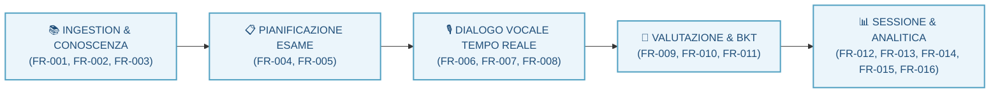
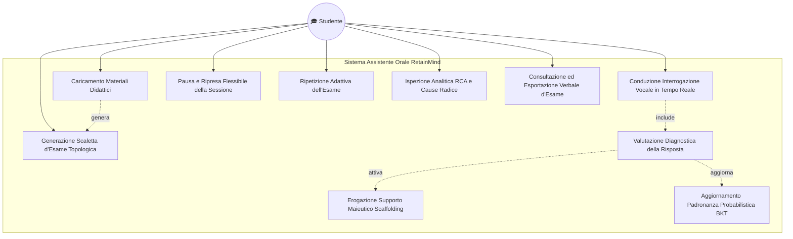
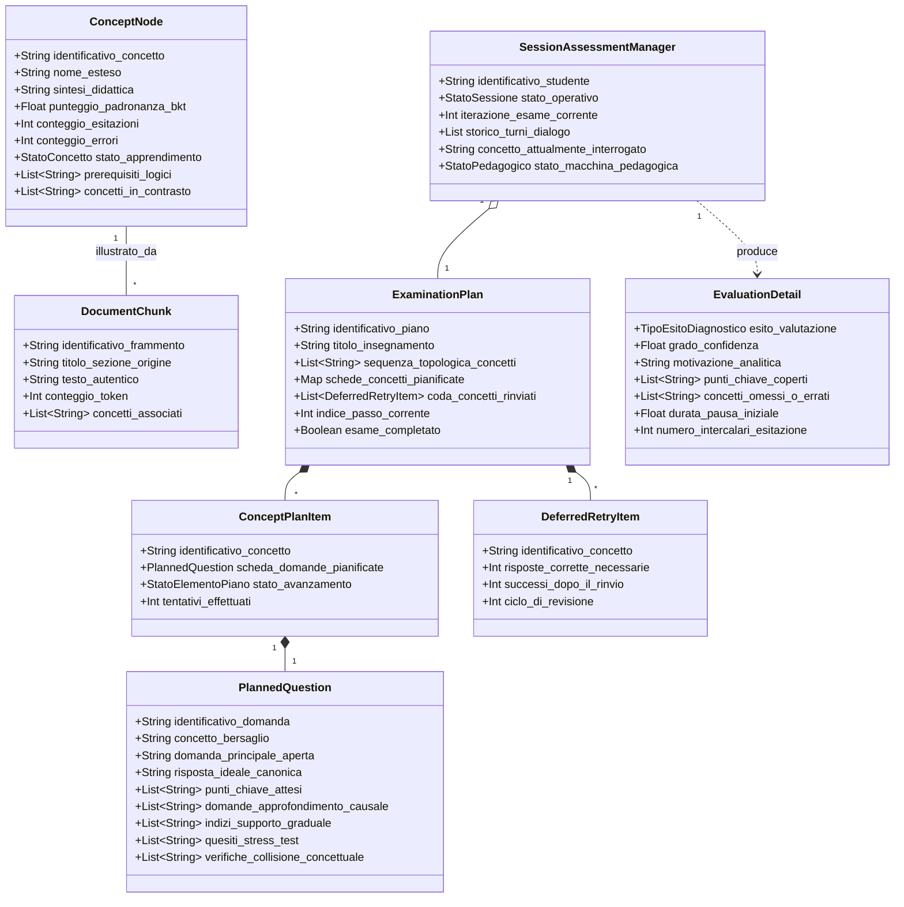
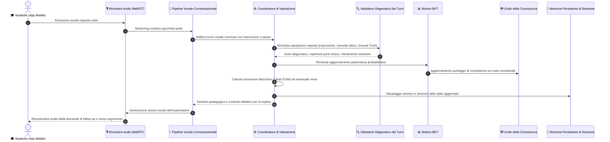
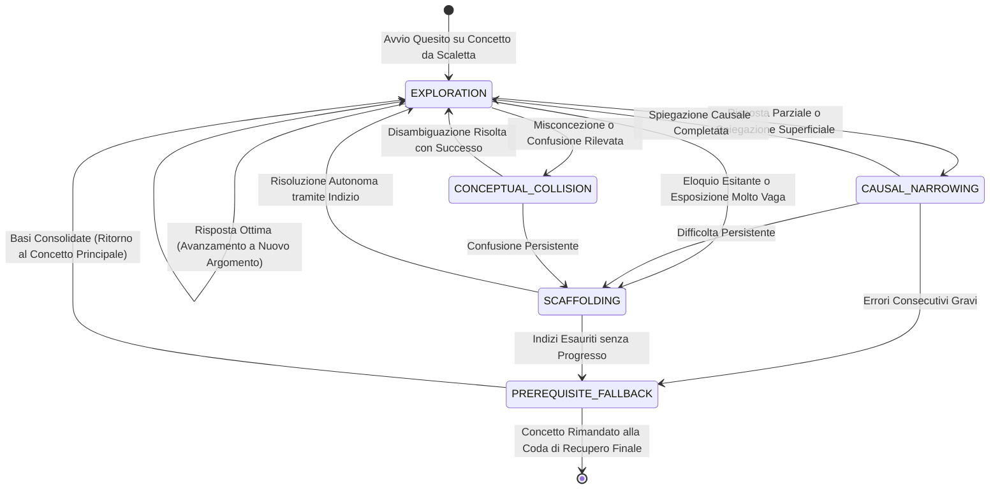
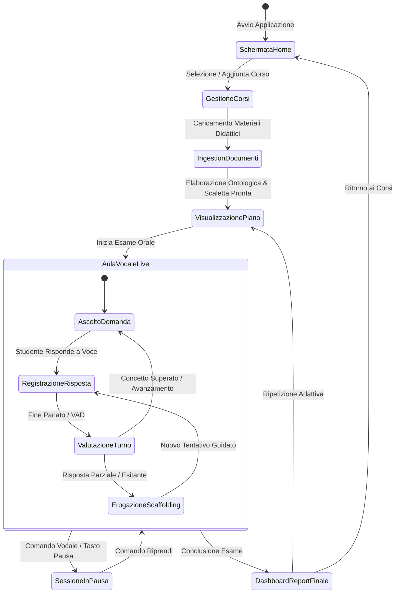

  
  
  # Requirements Analysis Document (RAD) — RetainMind

**Titolo del Documento:** Requirements Analysis Document (RAD) per l'Assistente allo Studio Orale RetainMind
**Nome del Progetto:** RetainMind
**Identificativo del Documento:** RM-RAD-2026-V2.0
**Modello di Riferimento:** Bruegge & Dutoit OOSE RAD Specification Template
**Autore:** Team di Ingegneria RetainMind

---

# 1. Introduzione

## 1.1 Scopo del sistema

Lo scopo fondamentale di **RetainMind** è fornire agli studenti universitari e dell'istruzione superiore un assistente vocale intelligente e autonomo, progettato per l'allenamento intensivo, la simulazione dialettica e la valutazione formativa in vista degli esami orali universitari. Il sistema si rivolge prioritariamente a discipline caratterizzate da un'elevata densità concettuale e complessità nozionistica, quali Informatica, Ingegneria, Medicina, Giurisprudenza, Economia e Fisica teorica.

Nel panorama educativo contemporaneo, la quasi totalità degli strumenti di supporto allo studio basati sulla tecnologia adotta modalità di interazione passive o semplificate: quiz a scelta multipla, schede mnemoniche digitali (*flashcard*) ed esercizi di riempimento testuale. Sebbene tali approcci risultino utili per memorizzare definizioni atomiche e dati isolati, essi falliscono radicalmente nel preparare lo studente alla prova d'esame orale. La discussione con un docente universitario richiede infatti competenze cognitive di ordine superiore:
* La capacità di formulare ragionamenti causali articolati (*multi-hop reasoning*), collegando nozioni propedeutiche a fenomeni complessi.
* La prontezza nel rispondere a tono e con proprietà di linguaggio specialistico sotto pressione temporale.
* La padronanza nell'orientarsi quando l'esaminatore pone domande di approfondimento (*narrowing questions*), propone casi limite (*stress-test*) o introduce nozioni apparentemente simili per verificare la solidità della comprensione concettuale.

RetainMind colma questa lacuna introducendo la figura dell'**Esaminatore Orale Socratico Autonomo**. Il sistema prende in carico i materiali didattici autentici forniti dallo studente (libri di testo, dispense dei professori, appunti e sintesi tematiche), li scompone e li analizza per distillare una vera e propria ontologia della disciplina. A partire da questa rete concettuale, RetainMind pianifica strategicamente l'interrogazione, stabilendo quali argomenti verificare per primi in base alle loro relazioni di propedeuticità logica. Durante il colloquio vocale in tempo reale, il sistema dialoga a voce con lo studente a bassa latenza, ne ascolta attentamente le risposte, misura la sicurezza espositiva, identifica con precisione chirurgica le lacune teoriche e le misconcezioni, applica tecniche di supporto graduale (*scaffolding*) e aggiorna costantemente la stima probabilistica della padronanza dello studente, offrendo infine un quadro diagnostico approfondito per guidare le successive sessioni di studio.

---

## 1.2 Ambito del sistema

### 1.2.1 Funzionalità nell'Ambito

* **Ingestion ed Elaborazione Concettuale dei Documenti Didattici:** Importazione automatica di materiali di studio digitali in molteplici formati testuali, con bonifica del contenuto verbale, conservazione della gerarchia delle sezioni e suddivisione semantica del testo.
* **Costruzione del Grafo Ontologico e Indicizzazione Vettoriale Ibrida (GraphRAG):** Riconoscimento dei concetti cardine della materia e delle loro connessioni semantiche (prerequisiti necessari, implicazioni causali, relazioni di contrasto e approfondimento), combinato con l'indicizzazione vettoriale per consentire il recupero istantaneo di passaggi fedeli (*Ground Truth*) a supporto di ogni quesito.
* **Pianificazione Topologica e Didattica dell'Esame:** Ordinamento rigoroso degli argomenti basato sull'analisi delle dipendenze concettuali (garantendo che le basi propedeutiche precedano i temi avanzati) e pre-generazione di schede didattiche complete (domanda aperta principale, risposta ideale, punti chiave irrinunciabili, sotto-domande di approfondimento, suggerimenti graduali e controlli di collisione).
* **Conduzione dell'Esame Vocale Bidirezionale Full-Duplex:** Interazione orale fluida in tempo reale con bassissima latenza, dotata di rilevamento vocale continuo, interruzione immediata della voce dell'esaminatore non appena lo studente prende la parola (*barge-in*) e supporto sia per modelli multimodali nativi a voce sia per pipeline a cascata.
* **Instradamento Intelligente dei Turni di Parola (Turn Routing):** Discriminazione immediata tra una reale risposta d'esame, una richiesta operativa di pausa/ripresa, una domanda di chiarimento didattico o una digressione fuori tema, instradando ciascun intento senza penalizzazioni o consumi indebiti di tentativi.
* **Valutazione Diagnostica Sfaccettata e Analisi delle Esitazioni:** Confronto qualitativo e quantitativo dell'argomentazione dello studente rispetto ai punti chiave attesi, integrato con l'analisi delle pause iniziali e dei riempitivi verbali per discriminare sicurezza, esitazione, vaghezza o misconcezione.
* **Tracciamento Probabilistico della Conoscenza (Bayesian Knowledge Tracing):** Modellazione matematica dello stato cognitivo latente per ciascun argomento, distinguendo scivoloni accidentali (*slip*) da intuizioni casuali (*guess*) per stimare con precisione la padronanza effettiva.
* **Guida Didattica Adattiva a Macchina a Stati Finiti (FSM):** Regolazione della postura dell'esaminatore tramite stati pedagogici dedicati (esplorazione ordinaria, focalizzazione causale, supporto graduale con indizi, disambiguazione concettuale e recupero sui prerequisiti).
* **Coda di Rinvio Ciclica per il Recupero delle Fragilità:** Gestione flessibile dei concetti non superati o saltati, che vengono reinseriti in una coda di ripasso e riproposti allo studente verso la fine del colloquio.
* **Conservazione Atomica dello Stato e Analisi delle Cause Radice (Root Cause Analysis - RCA):** Registrazione sincrona della memoria d'esame a ogni turno per consentire il ripristino istantaneo in caso di disconnessione, confronto longitudinale tra prove successive ed elaborazione di verbali analitici che tracciano l'origine delle difficoltà teoriche.

### 1.2.2 Funzionalità Fuori Ambito

* **Sessioni d'Esame Collettive Simultanee:** Il sistema è progettato per il colloquio individuale uno-a-uno; non supporta stanze vocali simultanee con più studenti esaminati insieme.
* **Verbalizzazione e Integrazione con Registri Universitari:** L'attribuzione di voti con valore legale e la registrazione automatica sui portali accademici istituzionali esulano dalle finalità della piattaforma.
* **Videosorveglianza e Riconoscimento Biometrico (Proctoring):** Il sistema non include algoritmi invasivi di videosorveglianza, puntamento oculare o verifica biometrica dell'identità.

---

## 1.3 Obiettivi e criteri di successo del progetto

### 1.3.1 Obiettivi del Progetto

1. **Interazione Vocale Naturale e Tempestiva:** Offrire un'esperienza conversazionale a bassa latenza paragonabile a un colloquio con un docente umano, azzerando le attese percepite.
2. **Ancoraggio Rigoroso e Assenza di Allucinazioni:** Vincolare ogni quesito e valutazione ai materiali caricati dallo studente, garantendo che il modello linguistico non inventi definizioni estranee al programma d'esame.
3. **Approccio Maieutico e Costruttivo:** Stimolare la riflessione critica guidata piuttosto che fornire giudizi sommari o soluzioni preconfezionate.
4. **Resilienza della Sessione di Studio:** Assicurare che nessuna interruzione di rete o chiusura accidentale dell'app provochi la perdita delle valutazioni o dell'avanzamento maturato.

### 1.3.2 Criteri di Successo

| ID Criterio | Ambito / Obiettivo | Metodo di Validazione e Risultato Atteso |
| :--- | :--- | :--- |
| **SC-01** | Coerenza Globale dell'Architettura | Esecuzione con esito positivo di tutti i test automatizzati sui moduli di ingestion, pianificazione, valutazione diagnostica e gestione della sessione. |
| **SC-02** | Stabilità del Flusso Audio e Barge-In | Verifica su dispositivi fisici della corretta acquisizione microfonica a due vie, della soppressione del riverbero e dell'arresto immediato della voce dell'agente al parlato dello studente. |
| **SC-03** | Determinismo delle Transizioni Pedagogiche | Controllo formale delle regole della macchina a stati finiti: a fronte di risposte parziali o errate, la transizione verso stati di supporto deve avvenire in modo coerente e predicibile. |
| **SC-04** | Integrità del Ripristino dello Stato | Capacità di riprendere un'interrogazione interrotta a metà senza alcuna perdita di punteggi, trascrizioni storiche o avanzamento nella scaletta dei concetti. |
| **SC-05** | Valutazione Longitudinale e Diagnosi RCA | Generazione di report coerenti che quantificano l'incremento di padronanza concettuale tra sessioni successive e rintracciano le cause radice dei fallimenti sui prerequisiti. |

---

## 1.4 Definizioni, acronimi e abbreviazioni

| Termine / Acronimo | Definizione Concettuale |
| :--- | :--- |
| **BKT** | *Bayesian Knowledge Tracing* — Modello matematico a rete bayesiana che aggiorna dinamicamente la probabilità a posteriori che uno studente padroneggi stabilmente un concetto teorico. |
| **Barge-in** | Meccanismo acustico che zittisce istantaneamente la sintesi vocale dell'esaminatore nel momento esatto in cui lo studente prende la parola. |
| **DAG** | *Directed Acyclic Graph* (Grafo Diretto Aciclico) — Struttura topologica in cui i concetti del corso sono nodi e le relazioni di propedeuticità sono archi orientati privi di cicli chiusi. |
| **FSM** | *Finite State Machine* (Macchina a Stati Finiti) — Modello di controllo che disciplina le strategie didattiche dell'esaminatore sintetico. |
| **GraphRAG** | Architettura combinata che unisce la navigazione strutturata sul grafo della conoscenza alla ricerca per similarità semantica vettoriale. |
| **Ground Truth** | Insieme dei frammenti e delle definizioni testuali fedeli estratti direttamente dai materiali caricati dallo studente, utilizzati come metro di verità per validare le risposte. |
| **Pipecat** | Framework specializzato per la composizione modulare di pipeline multimediali e conversazionali vocali in tempo reale. |
| **RCA** | *Root Cause Analysis* (Analisi delle Cause Radice) — Procedura diagnostica che risale la catena dei prerequisiti logici per individuare la lacuna originaria che ha provocato l'errore su un argomento complesso. |
| **Scaffolding** | Tecnica maieutica che fornisce aiuti e sotto-domande graduate per supportare lo studente nel dedurre autonomamente la risposta corretta. |
| **VAD** | *Voice Activity Detection* — Algoritmo che distingue in tempo reale la presenza di voce umana dal silenzio e dai rumori di fondo. |
| **WebRTC** | Protocollo standard per lo scambio bidirezionale di flussi multimediali (audio/video) in tempo reale su rete a bassa latenza. |

---

## 1.5 Riferimenti

1. **Metodologia del Dialogo Socratico e Apprendimento Attivo:** Principi di maieutica applicati all'istruzione superiore, alla formulazione di domande aperte e al rafforzamento della comprensione critica concettuale.
2. **Modellazione Cognitiva tramite Bayesian Knowledge Tracing:** Corbett, A. T., & Anderson, J. R. (1994). *Knowledge tracing: Modeling the acquisition of procedural knowledge*. User Modeling and User-Adapted Interaction, 4(4), 253-278.
3. **Architetture GraphRAG e Retrieval Ibrido:** Metodologie per l'indicizzazione e l'interrogazione congiunta di ontologie simboliche a grafo e rappresentazioni vettoriali dense nei modelli linguistici moderni.
4. **Standard OOSE (Object-Oriented Software Engineering):** Bruegge, B., & Dutoit, A. H. *Object-Oriented Software Engineering: Using UML, Patterns, and Java*. Prentice Hall.

---

## 1.6 Panoramica del documento

Il presente Requirements Analysis Document è strutturato in conformità al modello di specifica OOSE:
* **Sezione 2 (Sistema Attuale):** Descrive lo stato dell'arte e le modalità con cui gli studenti preparano tradizionalmente gli esami orali universitari, evidenziando le limitazioni cognitive, metodologiche e pratiche dei metodi correnti.
* **Sezione 3 (Sistema Proposto):** Documenta l'ingegneria dei requisiti e il modello di analisi del nuovo sistema. Include una panoramica approfondita del funzionamento passo-passo del backend (3.1), i requisiti funzionali formali (3.2), i requisiti non funzionali dettagliati (3.3) e la suite completa dei modelli di sistema (3.4) con scenari, casi d'uso, modello ad oggetti, modello dinamico e interfacce utente.
* **Sezione 4 (Glossario):** Fornisce un glossario organico dei termini tecnici, pedagogici e architetturali impiegati nella specifica, a garanzia di coerenza e univocità lessicale.

---

# 2. Sistema Attuale

## 2.1 Descrizione dello Stato dell'Arte

La preparazione degli esami orali universitari costituisce una delle sfide più complesse del percorso accademico. A differenza degli esami scritti o a test, in cui allo studente è richiesto di risolvere esercizi circoscritti o riconoscere risposte corrette tra opzioni prefissate, la prova orale richiede di:
* Esporre argomenti complessi con linearità logica e padronanza lessicale specialistica.
* Rispondere tempestivamente a obiezioni, richieste di chiarimento o approfondimenti causali.
* Dimostrare di aver compreso la gerarchia della materia, collegando nozioni di base a principi operativi avanzati.

Attualmente, gli studenti affrontano questo compito affidandosi a metodologie di studio tradizionali o a strumenti informatici di prima generazione:
1. **Studio Individuale Passivo e Ripetizione a Voce Alta:** Lo studente legge e rilegge i capitoli dei libri di testo, evidenzia passaggi ed elabora riassunti scritti. Successivamente tenta di ripetere a voce alta gli argomenti memorizzati, spesso confrontando la propria esposizione con il testo aperto davanti a sé.
2. **Strumenti Digitali a Schede Mnemoniche (Flashcard):** Piattaforme basate sulla ripetizione spaziata (quali Anki o SuperMemo) consentono di memorizzare definizioni e associazioni termine-concetto. Tali strumenti operano tipicamente mediante stimolo/risposta testuale sintetico con autovalutazione binaria (ricordato/dimenticato).
3. **Simulazioni Informali tra Pari (Gruppi di Studio):** Gli studenti si incontrano periodicamente per interrogarsi a vicenda, cercando di replicare la dinamica dell'esame attraverso domande estemporanee formulate dai colleghi di corso.
4. **Ricevimento Docenti e Tutorato Accademico:** Consultazione occasionale dei professori o dei cultori della materia durante le ore di ricevimento, limitata a chiarimenti puntuali su argomenti specifici.

---

## 2.2 Criticità e Problemi del Sistema Attuale

L'analisi dell'attuale modalità di preparazione rivela profonde debolezze sia sul piano cognitivo che su quello dell'efficienza didattica:

* **L'Illusione della Competenza (*Illusion of Explanatory Depth*):** Quando uno studente rilegge la dispensa o ripete a voce alta con il testo sott'occhio, il cervello confonde la *capacità di riconoscimento visivo* con la reale *capacità di rievocazione e argomentazione attiva*. Lo studente è convinto di padroneggiare la materia, ma va incontro a blocchi totali nel momento in cui un docente gli pone una domanda aperta senza appunti di supporto.
* **Mancanza di Feedback Socratico e Approfondimento Causale:** La ripetizione solitaria non offre alcuno stimolo esterno: se lo studente fornisce una spiegazione superficiale, tautologica o priva di nessi di causa-effetto, non c'è nessuno a fargli notare la debolezza logica o a chiedergli *"perché si verifica questo fenomeno?"*.
* **Incapacità di Riconoscere Misconcezioni Teoriche:** Nelle discipline scientifiche e umanistiche avanzate, molti concetti presentano forti somiglianze terminologiche pur descrivendo proprietà opposte. Nello studio tradizionale, lo studente finisce per confondere tali nozioni senza rendersene conto, scoprendo l'errore concettuale solo in sede d'esame formale.
* **Limiti Strutturali delle Flashcard Tradizionali:** Le schede digitali premiano la memorizzazione atomica e decontestualizzata. Non incoraggiano la formulazione di periodi verbali articolati né sanno valutare la proprietà di linguaggio o la sicurezza acustica dell'eloquio.
* **Inefficienza e Asimmetria dei Gruppi di Studio tra Pari:** Le simulazioni con compagni di corso soffrono di problemi di disponibilità oraria, imbarazzo sociale e, soprattutto, asimmetria di preparazione: se il collega che interroga non padroneggia a fondo la disciplina, non sarà in grado di correggere gli errori dell'interrogato né di condurre un colloquio rigoroso.
* **Assenza di Tracciamento Quantificato delle Lacune Radice:** Al termine di una giornata di ripetizione, lo studente non dispone di alcun quadro oggettivo che gli mostri quali siano i concetti realmente consolidati e quali siano le lacune sui prerequisiti che compromettono la comprensione degli argomenti complessi.

Questa marcata discrepanza tra le modalità di studio disponibili e le reali esigenze valutative dell'università evidenzia l'urgente necessità di un sistema capace di agire come un vero docente virtuale socratico.

---

# 3. Sistema Proposto

## 3.1 Panoramica Funzionale del Sistema

RetainMind ridefinisce radicalmente la preparazione agli esami orali introducendo un'infrastruttura intelligente in cui l'intelligenza artificiale opera non come un semplice generatore di risposte, ma come un **docente universitario virtuale rigoroso, empatico e metodologicamente fondato**.

L'architettura del sistema si fonda su un modello client-server reattivo:
* Il **Client Mobile** offre allo studente un ambiente pulito per importare i materiali didattici, visualizzare la scaletta della materia e sostenere la prova orale a mani libere con streaming audio a bassissima latenza.
* Il **Server Applicativo e Backend Pedagogico** orchestra l'elaborazione dei documenti, la costruzione della base di conoscenza, la pianificazione didattica, la conduzione del colloquio vocale e l'analisi probabilistica della conoscenza.

```mermaid
flowchart TB
    subgraph ClientLayer ["📱 CLIENT MOBILE — STUDENTE"]
        UI["Interfaccia Utente Mobile
(Gestione Corsi, Scalette & Report)"]
        AudioClient["Streaming Audio WebRTC Full-Duplex
(Cancellazione Riverbero & Barge-in)"]
        Controls["Console di Controllo
(Pausa, Ripresa, Ripetizione, Salto)"]
    end

    subgraph ServerGateway ["🌐 SERVER APPLICATIVO & GATEWAY MULTIMEDIALE"]
        REST["Servizi Web REST
(Gestione Corsi, Piani & Autenticazione)"]
        Signaling["Gateway di Segnalazione WebRTC
(Negoziazione SDP & Scambio ICE)"]
        Lifecycle["Coordinamento Ciclo di Vita Sessione
(Persistenza Sincrona & Ripristino)"]
    end

    subgraph VoiceEngine ["🎙️ PIPELINE VOCALE CONVERSAZIONALE"]
        GeminiLive["Modello Multimodale Vocale Nativo
(Comprensione Diretta & Voce Espressiva)"]
        Cascaded["Pipeline Alternativa a Cascata
(STT → LLM → TTS)"]
        VAD["Rilevamento Attivita Vocale (VAD)
& Instradamento Intelligente Turni"]
    end

    subgraph PedagogicalEngine ["🧠 MOTORE DI VALUTAZIONE & BKT"]
        Evaluator["Valutatore Diagnostico dei Turni
(Confronto Punti Chiave & Analisi Esitazioni)"]
        BKT["Bayesian Knowledge Tracing (BKT)
(Stima Continua Padronanza Latente)"]
        FSM["Macchina a Stati Finiti (FSM)
(Strategia Didattica & Scaffolding)"]
        RCA["Analisi Cause Radice (RCA)
(Diagnosi Propedeuticita & Coda Rinvio)"]
    end

    subgraph StorageLayer ["💾 ARCHIVI DELLA CONOSCENZA & PERSISTENZA"]
        GraphStore["Grafo della Conoscenza Ontologico
(Prerequisiti, Contrasti & Implicazioni)"]
        VectorStore["Indice Vettoriale Semantico
(Recupero Ground Truth da Materiali)"]
        PlanStore["Struttura del Piano d'Esame
(Scaletta Topologica & Blueprint Domande)"]
        StateStore["Memoria di Sessione Persistente
(Salvataggio Atomico Turn-by-Turn)"]
    end

    ClientLayer <--> ServerGateway
    ServerGateway <--> VoiceEngine
    VoiceEngine <--> PedagogicalEngine
    PedagogicalEngine <--> StorageLayer
```

### Funzionamento Dettagliato del Backend Passo dopo Passo

L'intero ciclo di elaborazione del backend si articola in una sequenza continua di undici passaggi operativi:

#### 1. Ingestion dei Documenti Didattici e Segmentazione Semantica
Lo studente carica i propri testi di studio (libri di testo, slide, dispense o riassunti). Il backend ne riconosce la struttura, bonifica il testo preservando la gerarchia dei capitoli ed esegue una segmentazione semantica (*chunking*) a finestra scorrevole: ogni frammento racchiude un pensiero logico completo ed è provvisto di sovrapposizione concettuale con i frammenti adiacenti, garantendo che le informazioni rimangano integre.

#### 2. Estrazione Ontologica e Costruzione del Grafo della Conoscenza
Un modello linguistico specializzato analizza i frammenti informativi ed estrae la rete ontologica della materia:
* *Nodi Concettuali:* Ogni nozione cardine del corso viene formalizzata con nome accademico, sintesi teorica rigorosa e grado di astrazione.
* *Relazioni Ontologiche Tipizzate:* Vengono tracciati archi orientati di prerequisito logico (`REQUIRES`), implicazione causale (`CAUSES`), contrasto concettuale o confondibilità (`CONTRASTS_WITH`) e approfondimento specialistico (`EXPANDS`). La rete risultante viene salvata nel grafo della conoscenza del corso.

#### 3. Indicizzazione Vettoriale e Base di Conoscenza Ibrida (GraphRAG)
Ogni frammento testuale originario viene convertito in un vettore denso e archiviato nell'indice vettoriale. Ogni nodo concettuale del grafo viene collegato ai passaggi esatti del testo da cui è stato distillato (*Ground Truth*). Durante l'esame, il sistema unisce l'esplorazione topologica del grafo alla ricerca per similarità semantica, assicurando che le domande e le valutazioni siano blindate contro qualsiasi allucinazione.

#### 4. Pianificazione Didattica Topologica dell'Esame
Il backend genera in anticipo una scaletta d'esame strutturata applicando un ordinamento topologico sul grafo delle propedeuticità concettuali:
* I principi introduttivi e le definizioni di base vengono affrontati per primi.
* I meccanismi applicativi intermedi occupano la fase centrale.
* I temi complessi di sintesi avanzata vengono proposti solo dopo aver accertato la comprensione delle basi.
Per ogni argomento, il sistema pre-calcola una scheda didattica completa contenente: domanda principale aperta, risposta ideale, punti chiave irrinunciabili, sotto-domande di approfondimento causale, indizi graduali di aiuto (*scaffolding*), verifiche per risposte recitate a memoria e controlli di collisione concettuale.

#### 5. Negoziazione Multimediale e Apertura dell'Aula Vocale
All'avvio dell'esame da parte dello studente, il client e il server negoziano una connessione audio bidirezionale a bassa latenza su protocollo WebRTC. Viene inizializzata la pipeline conversazionale e l'esaminatore sintetico porge vocalmente un saluto introduttivo, enunciando il programma e ponendo la prima domanda aperta prevista dalla scaletta.

#### 6. Rilevamento della Voce (VAD), Interruzioni (Barge-in) e Instradamento dei Turni
Durante il dialogo, il sistema rileva con precisione l'attività vocale dello studente e ne rispetta le pause riflessive naturali. Se lo studente parla mentre l'esaminatore sta parlando, la sintesi vocale si interrompe all'istante (*barge-in*). Prima di valutare l'intervento, un modulo di instradamento intelligente classifica l'intento:
* I comandi operativi (*"Pausa"*, *"Riprendiamo"*, *"Salta"*) vengono eseguiti senza intaccare i punteggi né consumare tentativi.
* Le richieste di chiarimento didattico (*"Cosa intendi con questa parola?"*) ricevono una delucidazione concisa senza penalità.
* Le digressioni fuori tema vengono riorientate con garbo verso l'argomento attivo.
* Le risposte d'esame sostanziali vengono immediatamente inoltrate alla valutazione diagnostica.

#### 7. Valutazione Diagnostica Sfaccettata della Risposta
La trascrizione dell'intervento viene analizzata rispetto ai punti chiave attesi, misurando la presenza dei concetti irrinunciabili, la proprietà lessicale e i segnali acustico-temporali di incertezza (durata delle pause iniziali, densità di intercalari). Il turno viene classificato in una categoria diagnostica rigorosa: `ACCURATE` (completa e sicura), `PARTIAL` (corretta ma incompleta), `VAGUE` (superficiale o tautologica), `HESITANT` (corretta ma incerta ed esitante), `MISCONCEPTION` (confusione con un'altra nozione teorica) o `MEMORIZED` (ripetizione letterale mnemonica).

#### 8. Tracciamento Probabilistico della Padronanza Cognitiva (BKT)
L'esito diagnostico aggiorna la stima della padronanza latente $P(L_t) \in [0.0, 1.0]$ attraverso il modello di Bayesian Knowledge Tracing. Il modello calcola matematicamente la competenza reale ponderando le risposte su due parametri cognitivi: la probabilità di compiere uno scivolone accidentale (*slip*) e la probabilità di indovinare casualmente (*guess*). Inoltre, collegando il BKT al grafo ontologico, l'algoritmo di Root Cause Analysis (RCA) deduce se una difficoltà su un tema avanzato scaturisce dalla mancata assimilazione di un prerequisito fondamentale a monte.

#### 9. Scelte Pedagogiche della Macchina a Stati Finiti (FSM) e Direttive Vocali
In base alla nuova stima di competenza, una Macchina a Stati Finiti pedagogica stabilisce la mossa successiva:
* `EXPLORATION`: Convalida la risposta positiva e avanza al nuovo argomento in programma.
* `CAUSAL_NARROWING`: Pone una domanda mirata per far emergere i nessi logici di causa-effetto omessi.
* `SCAFFOLDING`: Offre un indizio progressivo per guidare lo studente esitante alla formulazione autonoma.
* `CONCEPTUAL_COLLISION`: Disambigua una misconcezione chiedendo di chiarire le differenze rispetto alla nozione opposta.
* `PREREQUISITE_FALLBACK`: Sospende temporaneamente il concetto complesso dopo ripetuti fallimenti e ripiega sul prerequisito debole per risanare le basi.
La direttiva didattica viene inviata alla pipeline vocale, che la pronuncia con tono naturale ed empatico.

#### 10. Amministrazione della Coda di Recupero Ciclica
I concetti non superati o temporaneamente sospesi non vengono scartati, ma confluiscono in una coda di recupero ciclica. Prima di dichiarare conclusa la sessione, l'esaminatore ripropone ordinatamente questi argomenti, offrendo allo studente la possibilità di riscattarsi grazie alle spiegazioni e ai chiarimenti maturati nel corso della discussione.

#### 11. Conservazione Atomica della Memoria di Sessione e Verbale Finale
A ogni singolo scambio verbale, l'intero stato della prova (trascrizioni, valutazioni, stime BKT, stato FSM e coda di recupero) viene registrato in modo atomico e persistente. Al termine del colloquio, il sistema redige un verbale diagnostico dettagliato che evidenzia i punti di forza, le aree di fragilità teorica, le misconcezioni rilevate e le indicazioni causali RCA, corredate da confronti longitudinali con le simulazioni d'esame precedenti.

---

## 3.2 Requisiti Funzionali

### 3.2.1 Ingestion e Costruzione della Conoscenza

| Id | Nome | Descrizione |
| :--- | :--- | :--- |
| **FR-001** | Ingestion Documentale Multi-Formato | Il sistema deve effettuare l'ingestion di file PDF, Markdown e testo semplice, estraendo contenuti strutturati, intestazioni e chunk testuali delimitati con metadati per l'indicizzazione. |
| **FR-002** | Estrazione Ontologica di Concetti e Relazioni | Il sistema deve estrarre concetti e relazioni dai materiali didattici analizzati, producendo entità concettuali connesse da relazioni semantiche tipizzate (`REQUIRES`, `CAUSES`, `CONTRASTS_WITH`, `EXPANDS`) nel grafo della conoscenza. |
| **FR-003** | Indicizzazione Vettoriale Ibrida e Retrieval Ground Truth | Il sistema deve generare embedding semantici densi per i chunk di testo e supportare il retrieval ibrido, estraendo passaggi testuali fedeli (*Ground Truth*) per ancorare l'interrogazione ai materiali del corso. |

### 3.2.2 Pianificazione dell'Esame

| Id | Nome | Descrizione |
| :--- | :--- | :--- |
| **FR-004** | Generazione del Piano d'Esame ad Ordinamento Topologico | Il sistema deve calcolare un ordinamento topologico dei nodi concettuali basato sui vincoli di prerequisito (`REQUIRES`), garantendo che i concetti propedeutici vengano verificati prima di quelli avanzati. |
| **FR-005** | Sintesi Predittiva dei Blueprint delle Domande | Per ciascun concetto nel piano, il sistema deve pre-generare o sintetizzare dinamicamente un set completo di blueprint interrogativi comprendente quesito principale, risposta ideale, punti chiave attesi, sonde di approfondimento e suggerimenti di scaffolding. |

### 3.2.3 Voce in Tempo Reale e Gestione del Dialogo

| Id | Nome | Descrizione |
| :--- | :--- | :--- |
| **FR-006** | Interrogazione Vocale Bidirezionale Full-Duplex | Il sistema deve condurre un'interrogazione vocale bidirezionale in tempo reale utilizzando il trasporto audio configurato (SmallWebRTC predefinito o WebSocket PCM di fallback) e la pipeline Pipecat. |
| **FR-007** | Supporto della Pipeline Vocale a Cascata Opzionale | Il sistema deve supportare anche una pipeline vocale sequenziale a cascata (STT → LLM → TTS) configurabile alternativamente a Gemini Live tramite apposito parametro di runtime. |
| **FR-008** | Gestione Immediata dell'Interruzione Vocale (Barge-In) | Il sistema deve arrestare istantaneamente la riproduzione vocale dell'agente nel momento in cui viene rilevata la voce dello studente (barge-in), prevenendo sovrapposizioni e collisioni conversazionali. |
| **FR-016** | Instradamento di Controlli, Chiarimenti e Digressioni Fuori Tema | Il sistema deve distinguere una risposta d'esame da comandi di pausa/ripresa/skip, da quesiti di chiarimento pertinenti e da digressioni palesemente fuori tema, instradandoli senza penalità né consumo di tentativi. |

### 3.2.4 Valutazione e Knowledge Tracing

| Id | Nome | Descrizione |
| :--- | :--- | :--- |
| **FR-009** | Valutazione Sfaccettata delle Risposte dello Studente | Il sistema deve confrontare la trascrizione dello studente con i punti chiave attesi per il quesito attivo e classificare la risposta tramite valutazione diagnostica in categorie tassonomiche (`ACCURATE`, `PARTIAL`, `VAGUE`, `HESITANT`, `MISCONCEPTION`, `MEMORIZED`). |
| **FR-010** | Scaffolding Dinamico e Approfondimento Mirato | Quando la valutazione evidenzia una risposta parziale, vaga o esitante, il sistema deve selezionare un'opportuna domanda di follow-up o un indizio graduale di scaffolding per stimolare l'auto-correzione dello studente. |
| **FR-011** | Aggiornamento della Padronanza tramite Bayesian Knowledge Tracing (BKT) | Il sistema deve aggiornare dinamicamente la stima probabilistica di padronanza latente $P(L_t)$ tramite Bayesian Knowledge Tracing (BKT) per il concetto attivo a seguito di ogni valutazione. |

### 3.2.5 Ciclo di Vita della Sessione e Analitica

| Id | Nome | Descrizione |
| :--- | :--- | :--- |
| **FR-012** | Persistenza Continua dello Stato di Sessione | Il sistema deve salvare sincronicamente lo stato completo della sessione su file persistente a ogni turno, consentendone il ripristino trasparente in caso di disconnessione. |
| **FR-013** | Pausa e Ripresa della Sessione Vocale e Programmatica | Il sistema deve consentire di mettere in pausa e riprendere la sessione d'esame in qualsiasi momento attraverso operazioni REST e comandi vocali dedicati, preservando l'avanzamento maturato. |
| **FR-014** | Ripetizioni Adattive su Più Iterazioni e Confronto Longitudinale | Il sistema deve supportare lo storico delle sessioni e il confronto longitudinale tra iterazioni d'esame successive, evidenziando i progressi netti e l'efficacia del recupero sulle aree deboli. |
| **FR-015** | Navigazione ed Esportazione della Trascrizione del Dialogo | Il sistema deve esporre la trascrizione completa del dialogo annotata turno per turno e i report analitici attraverso le API REST per la consultazione e l'esportazione dal client mobile e CLI. |

---

## 3.3 Requisiti Non Funzionali

### 3.3.1 Usabilità

| Id | Nome | Descrizione |
| :--- | :--- | :--- |
| **NFR-U-01** | Protocollo Socratico Vocale Naturale | L'esaminatore virtuale deve mantenere un tono conversazionale fluido, turni vocali concisi (non più di due o tre frasi alla volta) e uno stile accademico professionale ed empatico, evitando prolungati monologhi o cadenze robotiche innaturali. |
| **NFR-U-02** | Interazione a Mani Libere (Hands-Free) | Durante l'interrogazione orale, l'utente deve poter interagire esclusivamente tramite la voce senza necessità di toccare lo schermo, potendo al contempo usufruire di controlli tattili alternativi sull'app in qualsiasi momento. |
| **NFR-U-03** | Console di Gestione Chiara per Sviluppatori e Docenti | L'interfaccia di gestione a riga di comando per sviluppatori e docenti deve presentare report visivi chiari, indicatori testuali leggibili e schemi a colori intuitivi per verificare istantaneamente lo stato della sessione. |

### 3.3.2 Affidabilità

| Id | Nome | Descrizione |
| :--- | :--- | :--- |
| **NFR-R-01** | Resilienza e Ripristino Istantaneo della Sessione | Lo stato dell'esame deve essere registrato in modo sicuro a ogni scambio conversazionale, garantendo che a seguito di cadute di rete o chiusure improvvise la sessione sia ripristinabile senza perdere alcun progresso. |
| **NFR-R-02** | Gestione Elegante di Anomalie e Timeout Esterni | Qualora una chiamata verso i servizi di intelligenza artificiale remoti subisca un ritardo o un errore temporaneo, l'esaminatore deve formulare frasi di raccordo cortesi senza far cadere la connessione audio. |
| **NFR-R-03** | Disponibilità Continua dei Servizi di Memorizzazione | Il sistema deve poter operare sia interfacciandosi con database remoti dedicati sia affidandosi a motori leggeri integrati localmente in memoria, assicurando la piena operatività dell'ambiente di studio in qualsiasi contesto. |

### 3.3.3 Prestazioni

| Id | Nome | Descrizione |
| :--- | :--- | :--- |
| **NFR-P-01** | Latenza Conversazionale Reattiva | Il sistema deve minimizzare il tempo intercorrente tra la conclusione del parlato dello studente e l'avvio della risposta vocale dell'esaminatore, assicurando una sensazione di naturalezza nel colloquio d'esame. |
| **NFR-P-02** | Efficienza della Valutazione Locale | Le operazioni di analisi lessicale, aggiornamento delle stime bayesiane e selezione delle direttive pedagogiche devono completarsi in tempi trascurabili per non introdurre pause avvertibili nel dialogo. |
| **NFR-P-03** | Scalabilità dell'Ingestion Documentale | L'elaborazione, l'estrazione ontologica e l'indicizzazione dei documenti didattici devono scalare linearmente in base alla lunghezza del testo caricato, fornendo riscontri trasparenti sull'avanzamento. |

### 3.3.4 Supportabilità

| Id | Nome | Descrizione |
| :--- | :--- | :--- |
| **NFR-S-01** | Tracciamento Diagnostico Strutturato | Il sistema deve registrare log dettagliati su eventi di sessione, transizioni della macchina a stati finiti ed esiti delle valutazioni, garantendo al contempo la riservatezza delle informazioni dell'utente. |
| **NFR-S-02** | Verificabilità Automatizzata dei Moduli | L'intera logica di analisi pedagogica, calcolo probabilistico BKT e pianificazione topologica deve poter essere validata tramite una suite completa di test automatizzati indipendenti da risorse esterne. |
| **NFR-S-03** | Standard di Qualità del Codice | Il codice sorgente dell'intero ecosistema deve rispettare rigorosi standard di formattazione, analisi statica e tipizzazione per assicurare leggibilità e facilità di estensione nel tempo. |

### 3.3.5 Vincoli di Implementazione

| Id | Nome | Descrizione |
| :--- | :--- | :--- |
| **NFR-I-01** | Ambiente di Sviluppo Unificato e Gestione Dipendenze | Il backend deve essere sviluppato adottando un ecosistema moderno ad alte prestazioni con blocco deterministico delle versioni delle librerie terze per garantire la riproducibilità dell'ambiente. |
| **NFR-I-02** | Integrazione con Framework Multimediale a Streaming Vocale | L'infrastruttura vocale deve basarsi sull'orchestrazione unificata tra il server applicativo principale e il framework specializzato per la gestione dei flussi multimediali e delle pipeline conversazionali. |

### 3.3.6 Interfaccia

| Id | Nome | Descrizione |
| :--- | :--- | :--- |
| **NFR-IF-01** | Protocolli di Comunicazione Audio | Il client mobile adotta lo standard WebRTC per lo scambio a bassa latenza dei flussi multimediali, con negoziazione automatica di codec e parametri audio, mantenendo attiva una modalità di comunicazione full-duplex con cancellazione del riverbero. |
| **NFR-IF-02** | Interfacce di Servizio e Controllo | Le comunicazioni strutturate tra applicazione mobile e server applicativo avvengono mediante servizi web conformi ai principi REST per il controllo di sessione e protocolli di segnalazione dedicati per l'inizializzazione dei canali audio. |

### 3.3.7 Confezionamento

| Id | Nome | Descrizione |
| :--- | :--- | :--- |
| **NFR-PKG-01** | Avvio Unificato dell'Ambiente Locale | Il sistema deve fornire una procedura di inizializzazione semplificata per eseguire l'intero ambiente di backend, inclusi i servizi applicativi e la pipeline vocale, mediante un singolo comando integrato. |
| **NFR-PKG-02** | Gestione Gerarchica della Configurazione | La configurazione dei parametri di sistema e delle credenziali d'accesso deve supportare una gerarchia sicura, consentendo di sovrascrivere agevolmente le impostazioni globali con preferenze specifiche per l'ambiente locale. |

### 3.3.8 Requisiti Legali

| Id | Nome | Descrizione |
| :--- | :--- | :--- |
| **NFR-L-01** | Trattamento Temporaneo dell'Audio Vocale | I flussi sonori grezzi acquisiti durante l'interrogazione non devono essere archiviati a tempo indeterminato senza il consenso esplicito dello studente, in linea con i principi di minimizzazione del dato previsti dalle normative sulla privacy. |
| **NFR-L-02** | Pseudonimizzazione delle Tracce Didattiche | Tutte le registrazioni delle trascrizioni verbali, i punteggi di padronanza BKT e i verbali analitici devono essere memorizzati collegandoli a identificativi di sessione pseudonimizzati per tutelare l'identità dell'utente. |
| **NFR-L-03** | Protezione delle Credenziali dei Servizi Cognitivi | Le chiavi d'accesso ai servizi di intelligenza artificiale remoti devono risiedere esclusivamente nella memoria protetta dell'ambiente di esecuzione e non devono mai essere esposte pubblicamente o inserite nel codice sorgente. |

---

## 3.4 Modelli di Sistema

### 3.4.1 Scenari

#### Scenario 1: Caricamento del Documento Didattico e Generazione della Scaletta d'Esame
* **Attori:** Studente, Modulo di Ingestion Documentale, Pianificatore Didattico.
* **Precondizioni:** Lo studente ha a disposizione una dispensa universitaria in formato digitale (ad esempio sulle proprietà delle transazioni e della concorrenza nei sistemi di basi di dati).
* **Flusso degli Eventi:**
  1. Lo studente carica il testo didattico tramite l'interfaccia dell'applicazione mobile.
  2. Il server applicativo avvia la catena di elaborazione: il testo viene estratto, bonificato e segmentato in frammenti informativi omogenei.
  3. L'analizzatore ontologico esamina i frammenti ed estrae i concetti fondamentali (proprietà ACID, livelli di isolamento, serializzabilità e prevenzione dei deadlock), tracciando le reciproche relazioni di propedeuticità logica.
  4. Le entità concettuali vengono salvate nel grafo della conoscenza della materia e indicizzate vettorialmente.
  5. Il pianificatore d'esame esamina il grafo, ordina topologicamente gli argomenti e produce per ciascuno la scheda completa di domande aperte, risposte ideali, punti chiave e indizi di scaffolding.
  6. L'applicazione mobile mostra allo studente la panoramica degli argomenti estratti, consentendogli di avviare il colloquio orale.
* **Flussi di Errore:** Qualora il file caricato risulti danneggiato, il sistema segnala l'errore e invita al caricamento di un file integro.
* **Esito Finale:** Base di conoscenza e piano d'esame salvati e pronti per l'interrogazione.

#### Scenario 2: Conduzione dell'Interrogazione Orale e Supporto Graduale (Scaffolding)
* **Attori:** Studente, Esaminatore Vocale Socratico, Coordinatore della Valutazione.
* **Precondizioni:** Piano d'esame pronto e sessione vocale a bassa latenza stabilita con successo.
* **Flusso degli Eventi:**
  1. Lo studente avvia la simulazione d'esame dall'applicazione mobile; l'esaminatore sintetico porge il saluto introduttivo e propone la prima domanda in programma.
  2. L'esaminatore chiede: *"Quali principi fondamentali garantiscono che un insieme di operazioni sui dati venga trattato in modo affidabile come una transazione?"*
  3. Lo studente risponde vocalmente: *"I database usano le proprietà ACID. Ad esempio l'atomicità fa sì che tutte le operazioni vengano eseguite oppure nessuna."*
  4. Il valutatore diagnostico analizza la trascrizione verbale e rileva che la risposta è corretta ma incompleta rispetto ai punti chiave previsti, avendo tralasciato consistenza, isolamento e durabilità.
  5. Il coordinatore registra un esito parziale, aggiorna cautamente la stima di competenza BKT e dispone il passaggio a uno stato di focalizzazione causale.
  6. L'esaminatore sintetico interviene maieuticamente: *"Ottimo inizio sull'atomicità. Cosa puoi dirmi invece riguardo all'isolamento e alla durabilità dei dati al termine della transazione?"*
  7. Lo studente completa la spiegazione descrivendo come le modifiche sopravvivano ai guasti e come le transazioni concorrenti non debbano interferire tra loro.
  8. Il sistema riconosce la completa copertura dei punti chiave, incrementa la padronanza BKT e avanza all'argomento successivo.
* **Esito Finale:** Lo studente riceve un supporto maieutico che lo stimola a completare autonomamente l'argomentazione.

#### Scenario 3: Pausa della Prova e Ripresa Senza Perdita di Dati
* **Attori:** Studente, Esaminatore Vocale, Modulo di Persistenza della Sessione.
* **Precondizioni:** Interrogazione in corso con i primi tre argomenti della scaletta già affrontati con successo.
* **Flusso degli Eventi:**
  1. Lo studente pronuncia spontaneamente: *"Vorrei fare una pausa di cinque minuti."*
  2. Il modulo di instradamento intelligente riconosce il comando operativo di controllo, evitando di considerarlo una risposta d'esame e lasciando intatti i punteggi di competenza.
  3. L'esaminatore conferma la sospensione, commuta lo stato in pausa e salva in modo sincrono e atomico la memoria d'esame (cronologia turni, punteggi BKT e indice corrente della scaletta).
  4. Lo studente chiude temporaneamente l'applicazione per una pausa.
  5. Alla riapertura dell'app, lo studente richiede la ripresa dell'esame; il sistema recupera all'istante lo stato salvato e l'esaminatore riprende il colloquio esattamente dall'ultimo argomento rimasto in sospeso.
* **Esito Finale:** Perfetta continuità didattica senza ripetizioni forzate di domande già superate.

---

### 3.4.2 Modello dei Casi d'Uso

---

### 3.4.3 Modello ad Oggetti

---

### 3.4.4 Modello Dinamico

#### Diagramma di Sequenza del Turno di Colloquio Vocale

#### Macchina a Stati Finiti (FSM Pedagogica)

* **Stato `EXPLORATION` (Esplorazione Ordinaria):** Somministrazione standard della domanda aperta principale sul concetto in scaletta.
* **Stato `CAUSAL_NARROWING` (Focalizzazione Causale):** Richiesta di chiarire i passaggi logici di causa-effetto qualora l'argomentazione sia superficiale.
* **Stato `SCAFFOLDING` (Supporto Graduale):** Fornitura di indizi sequenziali calibrati per stimolare la deduzione autonoma della risposta corretta.
* **Stato `CONCEPTUAL_COLLISION` (Disambiguazione Concettuale):** Confronto diretto tra la nozione attiva e il concetto con cui è stata confusa.
* **Stato `PREREQUISITE_FALLBACK` (Recupero sui Prerequisiti):** Arretramento temporaneo della discussione sui concetti propedeutici a monte in caso di blocchi gravi.

---

### 3.4.5 Interfaccia Utente — Percorsi di Navigazione e Mockup delle Schermate

#### 1. Percorsi di Navigazione dell'Interfaccia Utente

Il flusso di interazione dell'applicazione mobile guida lo studente attraverso gli stati operativi del percorso di studio:

#### 2. Mockup e Struttura delle Schermate Principali

L'interfaccia utente è progettata per massimizzare la concentrazione durante il colloquio orale, riducendo al minimo gli elementi di disturbo visivo:

* **Canvas dell'Aula Vocale Live:**
  * *Barra di Stato Superiore:* Mostra l'insegnamento attivo, lo stato della sessione vocale e l'indicatore percentuale di completamento della prova con barra di avanzamento dinamica.
  * *Visualizzatore di Stato Acustico:* Elemento circolare centrale che anima pulsazioni visive per segnalare quando l'esaminatore sintetico sta parlando, quando è in corso l'ascolto dello studente o quando è attivo il rilevamento VAD.
  * *Riquadro del Dialogo Attivo:* Trascrizione ad alta leggibilità dell'ultimo quesito socratico formulato, per supportare la comprensione anche in ambienti rumorosi.
  * *Pulsantiera dei Controlli Rapidi:* Tasti touch ad alto contrasto per i comandi manuali di supporto (Pausa, Salta Argomento, Concludi Sessione), utilizzabili in alternativa ai comandi vocali a mani libere.

* **Dashboard Analitica del Verbale Finale e Ispezione CLI:**
  * *Quadro Generale delle Competenze:* Prospetto riepilogativo con metrica di padronanza globale BKT calcolata sull'intero corso.
  * *Sezione Aree di Fragilità & RCA:* Elenco analitico dei concetti critici con indicazione esplicita della causa radice individuata sui rispettivi prerequisiti nel grafo.
  * *Cronologia Completa dei Turni:* Registro dettagliato di ciascuno scambio verbale studente-esaminatore, annotato con tempi di risposta, conteggio intercalari di esitazione ed esito diagnostico.

---

# 4. Glossario

Il presente glossario raccoglie e definisce formalmente i termini cardine, i concetti pedagogici e le nozioni architetturali utilizzate nella specifica del sistema:

* **Analisi Acustico-Temporale:** Tecnica di elaborazione del parlato volta a misurare parametri prosodici e temporali, quali la durata del silenzio trascorso prima della risposta e la frequenza di riempitivi verbali (*filler words*), per valutare la sicurezza espositiva dello studente.
* **Barge-in (Interruzione Spontanea):** Capacità del sottosistema audio di arrestare istantaneamente la sintesi vocale dell'esaminatore nel momento esatto in cui viene rilevata la voce dell'utente, prevenendo sovrapposizioni e riproducendo la naturalezza del dialogo umano.
* **Bayesian Knowledge Tracing (BKT):** Modello matematico probabilistico a rete bayesiana che stima in tempo reale la probabilità latente $P(L_t)$ che uno studente abbia interiorizzato stabilmente un concetto, tenendo conto di sviste accidentali (*slip*) o risposte esatte casuali (*guess*).
* **Blueprint delle Domande:** Scheda didattica pre-calcolata associata a ciascun concetto della scaletta, comprendente la domanda aperta principale, la spiegazione ideale, i punti chiave irrinunciabili, le sonde di approfondimento e gli indizi di scaffolding.
* **Coda di Rinvio Ciclica (Deferred Retry Queue):** Registro dinamico in cui confluiscono temporaneamente i concetti su cui lo studente ha manifestato incertezze o che ha chiesto di saltare, per essere riproposti verso il termine della sessione.
* **Collisione Concettuale (Conceptual Collision):** Situazione in cui lo studente confonde il concetto interrogato con una nozione correlata o apparentemente simile collegata da un arco ontologico di contrasto.
* **Directed Acyclic Graph (DAG):** Grafo orientato privo di cicli in cui i nodi rappresentano i concetti didattici e gli archi orientati definiscono i vincoli di propedeuticità logica necessaria.
* **Esaminatore Socratico Autonomo:** Agente intelligente che conduce la prova orale adottando il metodo maieutico socratico, ponendo domande aperte, ascoltando le risposte e guidando lo studente all'auto-correzione tramite indizi progressivi.
* **Finite State Machine Pedagogica (FSM):** Macchina a stati finiti deterministica che disciplina la postura e la strategia educativa dell'esaminatore (esplorazione, focalizzazione causale, supporto graduale, disambiguazione e recupero sui prerequisiti).
* **GraphRAG (Hybrid Retrieval-Augmented Generation):** Architettura di reperimento informativo che integra l'esplorazione simbolica del grafo ontologico con la ricerca per similarità semantica su indici vettoriali densi.
* **Ground Truth (Verità di Riferimento):** Insieme delle definizioni e dei passaggi testuali fedeli estratti direttamente dai materiali didattici caricati dallo studente, utilizzati come metro oggettivo di validazione delle risposte.
* **Ingestion Documentale:** Procedura automatizzata di importazione, parsing, bonifica e segmentazione dei file didattici per renderli strutturati e interrogabili.
* **Ordinamento Topologico:** Algoritmo matematico che ordina linearmente i nodi di un DAG in modo tale che ogni concetto propedeutico preceda sempre i concetti avanzati che dipendono da esso.
* **Persistenza Continua e Atomica:** Meccanismo di salvataggio sincrono dello stato completo della sessione a ogni turno conversazionale, garantendo l'integrità del percorso d'esame contro cadute di connessione o chiusure impreviste.
* **Prerequisito Logico (`REQUIRES`):** Relazione ontologica formale che vincola la comprensione di un concetto avanzato alla preventiva assimilazione di una nozione di base.
* **Root Cause Analysis (RCA):** Procedura di risalita a ritroso del grafo della conoscenza che identifica l'origine causale profonda di un fallimento su un tema complesso in una lacuna pregressa su un concetto propedeutico.
* **Scaffolding Didattico:** Metodologia educativa che fornisce allo studente aiuti parziali e progressivi per colmare un'incertezza, stimolandolo a dedurre autonomamente la soluzione.
* **Segmentazione Semantica (Chunking):** Partizionamento del testo continuo in blocchi informativi omogenei e autosufficienti con sovrapposizione controllata tra frammenti adiacenti.
* **Turn Routing (Instradamento dei Turni):** Classificazione preventiva dell'intento comunicativo dello studente per distinguere comandi di controllo, richieste di chiarimento e digressioni dalle reali risposte accademiche d'esame.
* **Voice Activity Detection (VAD):** Algoritmo di analisi del segnale acustico capace di discriminare in tempo reale il parlato umano dal silenzio e dai rumori ambientali.
* **WebRTC:** Protocollo di comunicazione peer-to-peer per lo streaming bidirezionale di flussi multimediali a bassissima latenza.
