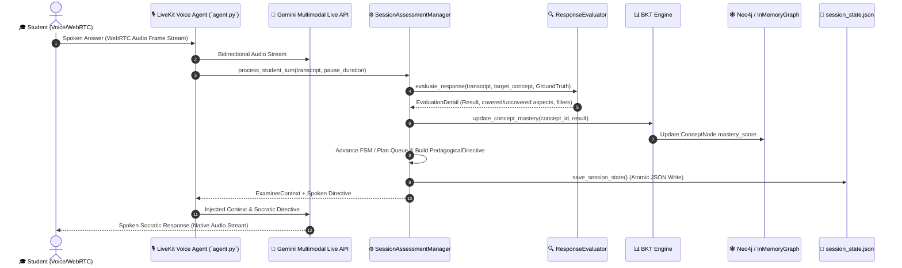
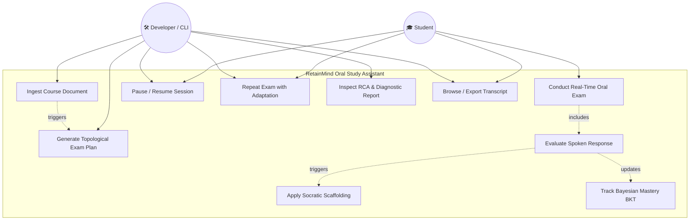
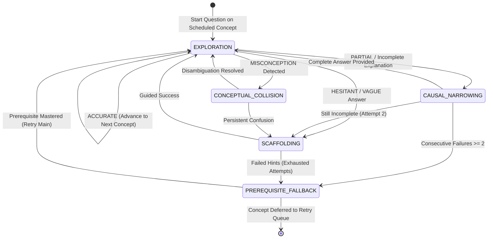

# Requirements Analysis Document (RAD) — RetainMind

**Document Title:** Requirements Analysis Document (RAD) for RetainMind Oral Study Assistant  
**Project Name:** RetainMind  
**Document Identifier:** RM-RAD-2026-V2.0  
**Current Milestone:** Architecture Consolidation & LiveKit Voice Pipeline v2.0  
**Compliance Standards:** IEEE Std 830-1998 / ISO/IEC/IEEE 29148:2018  
**Author:** RetainMind Engineering Team  

---

# 1. Introduction

## 1.1 Purpose of the system

The purpose of **RetainMind** is to deliver an AI-native, voice-first oral examination and continuous assessment assistant for university and higher-education students in cognitively demanding, high-density academic disciplines (e.g., Computer Science, Medicine, Law, Engineering, and Physics).

Traditional computer-assisted learning tools rely predominantly on passive multiple-choice quizzes or static text flashcards (e.g., Anki, SuperMemo). While effective for memorizing atomic facts, such tools fail to prepare students for the systemic rigors of formal oral examinations, which require articulate verbal explanations, multi-hop reasoning, causal attribution, and rapid real-time defense of conceptual arguments. 

RetainMind addresses this pedagogical gap by functioning as an **Autonomous Socratic Oral Examiner**. The system ingests authentic course materials (PDF textbooks, lecture slides, Markdown notes), constructs an ontological knowledge graph and dense vector index, derives a topologically structured examination plan, and conducts a bidirectional, full-duplex spoken interrogation session. During the interrogation, the system analyzes student answers for conceptual accuracy, pauses, and verbal hesitation, updating a real-time **Bayesian Knowledge Tracing (BKT)** model to dynamically adapt questioning strategies, provide scaffolded guidance, and perform longitudinal root-cause analysis (RCA).

---

## 1.2 Scope of the system

### 1.2.1 In-Scope Capabilities (Current & Proposed)

* **Document Ingestion & Extraction:** Automated ingestion of PDF, Markdown, and TXT documents; layout-aware extraction; OCR fallback via Tesseract; and semantic chunking.
* **Ontological Graph & Vector Indexing:** Extraction of `ConceptNode` entities, directed relationships (`REQUIRES`, `CAUSES`, `CONTRASTS_WITH`, `EXPANDS`), and text chunks stored in dual databases (**Neo4j** for graph topology and **Qdrant** for dense vector embeddings), with in-memory stores provided for testing and offline development.
* **Topological Examination Planning:** Automated derivation of structured `ExaminationPlan` objects with pre-calculated question blueprints (main Socratic inquiry, narrowing probes, scaffolding hints, collision checks) ordered by topological prerequisite dependencies.
* **Full-Duplex Speech-to-Speech (S2S) Voice Agent:** Real-time conversational oral examination powered by **LiveKit Agents**, utilizing the **Google Gemini Multimodal Live API** (`gemini-3.8-live`) for native audio-to-audio streaming, paired with neural noise suppression (`ai_coustics`).
* **Cascaded Pipeline Fallback:** Modular fallback architecture supporting streaming Speech-to-Text (**Deepgram Nova-3**), Large Language Model reasoning (**Gemma 4 31B-IT** / **GPT-4.1-mini**), and Text-to-Speech (**ElevenLabs Turbo v2.5** / **Cartesia Sonic-3**).
* **Multi-Faceted Response Evaluation & Cognitive Biomarkers:** Real-time analysis of phonetic transcriptions, semantic coverage (`covered_aspects` vs. `uncovered_aspects`), acoustic pause durations, and verbal hesitation markers (`HESITATION_WORDS`, `STT_CORRECTIONS`).
* **Bayesian Knowledge Tracing (BKT) & Pedagogical FSM:** Real-time tracking of latent concept mastery probabilities, driving a pedagogical Finite State Machine with dynamic states (`EXPLORATION`, `CAUSAL_NARROWING`, `SCAFFOLDING`, `CONCEPTUAL_COLLISION`, `PREREQUISITE_FALLBACK`).
* **Dynamic Spaced-Repetition Retry Queue:** Cyclic deferral of failed or skipped concepts, ensuring students are re-tested on weak concepts only after demonstrating mastery on intermediate topics.
* **Session Lifecycle, Longitudinal Analytics & Persistence:** Mid-exam pausing, seamless resumption, multi-iteration retakes with dynamic pedagogical recalibration, $\Delta\text{Mastery}$ delta tracking, prerequisite Root Cause Analysis, complete turn-by-turn conversation logging, and CLI management.

### 1.2.2 Out-of-Scope Capabilities (Explicitly Excluded / Deprecated)

* **Legacy E-Commerce & User Profile Management:** All legacy modules regarding shopping carts, orders, product catalogs, customer profiles, and general-purpose CRUD operations have been permanently excised from the codebase.
* **Third-Party LMS Synchronizers (Canvas/Moodle/Blackboard):** Direct automated synchronization with proprietary university gradebooks is excluded from the current release.
* **Synchronous Multi-Student Group Oral Exams:** The system is exclusively scoped for 1-on-1 student-examiner interactions.

---

## 1.3 Objectives and success criteria of the project

### 1.3.1 Primary Technical Objectives

1. **Sub-Second Voice Turnaround:** Maintain an end-to-end voice round-trip latency $\le 750\text{ ms}$ (p90) in native Gemini Live S2S mode over standard broadband/5G connections.
2. **Context-Grounding Fidelity:** Zero hallucinated technical facts during questioning; all Socratic probes and ideal answers must be anchored directly in ingested course excerpts (Ground Truth).
3. **Dynamic Pedagogical Scaffolding:** Guarantee that $100\%$ of partial or hesitant answers trigger bespoke, real-time scaffolding prompts targeting specific unmentioned concepts (`uncovered_aspects`) rather than static, repetitive feedback.
4. **State Persistence Integrity:** $0\%$ data loss upon sudden network drops, process termination, or explicit mid-session pauses, preserving all conversation turns, BKT mastery weights, and queue pointers.

### 1.3.2 Measurable Success Criteria

| Criterion ID | Metric / Target | Verification Method |
| :--- | :--- | :--- |
| **SC-01** | Test Suite Coverage $\ge 90\%$ across assessment, planning, and RAG layers | Automated `pytest` execution (27+ integration and unit tests passing) |
| **SC-02** | Voice Activity Detection (VAD) accuracy $\ge 98\%$ without false cutoffs | LiveKit Silero VAD calibration and speech boundary validation |
| **SC-03** | Pedagogical State Machine correctness ($100\%$ valid transitions) | FSM transition property-based automated tests |
| **SC-04** | Atomic State Persistence upon interruption ($< 5\text{ ms}$ write overhead) | JSON file serialization benchmarks under concurrent loads |
| **SC-05** | Longitudinal Adaptation Accuracy ($\ge 80\%$ correlation with weak areas) | Multi-iteration comparison test suite (`test_session_repeat_and_dynamic_adaptation`) |

---

## 1.4 Definitions, acronyms, and abbreviations

| Term / Acronym | Definition |
| :--- | :--- |
| **AEC** | Acoustic Echo Cancellation — algorithms mitigating speaker audio feedback into the microphone. |
| **BKT** | Bayesian Knowledge Tracing — a probabilistic graphical model estimating latent student concept mastery $P(L_t)$. |
| **CCS** | Causal Coherence Score — structural metric evaluating the logical and causal validity of an explanation. |
| **DAG** | Directed Acyclic Graph — topological representation of course concepts and prerequisite dependencies. |
| **FD** | Filler Density — metric computing frequency of non-lexical verbal hesitations (e.g., *ehm*, *tipo*, *uhm*) per utterance. |
| **FSM** | Finite State Machine — mathematical model governing examiner pedagogical dialogue states. |
| **GraphRAG** | Hybrid Retrieval-Augmented Generation combining ontological graph traversals with dense vector similarity search. |
| **Ground Truth** | Verbatim reference excerpts extracted from ingested course literature used to validate student claims. |
| **LiveKit** | Real-Time Communications (RTC) WebRTC infrastructure framework orchestrating audio rooms and agents. |
| **RCA** | Root Cause Analysis — algorithm identifying deep-seated prerequisite failures underlying higher-level concept errors. |
| **RLI** | Response Latency Index — duration of silence (in seconds) between examiner prompt completion and student speech onset. |
| **S2S** | Speech-to-Speech — bidirectional native audio streaming without intermediate text representation bottlenecks. |
| **Scaffolding** | Pedagogical technique offering guided hints and sub-questions to help a struggling student deduce the correct answer. |
| **STT / TTS** | Speech-to-Text (Transcription) / Text-to-Speech (Synthesis). |
| **VAD** | Voice Activity Detection — neural classification distinguishing human speech from ambient acoustic noise. |

---

## 1.5 References

1. **Original Specification:** `RetainMind_Technical_RAG_Specification.md` (Initial Conceptual Blueprint).
2. **IEEE Std 830-1998:** IEEE Recommended Practice for Software Requirements Specifications.
3. **ISO/IEC/IEEE 29148:2018:** Systems and software engineering — Life cycle processes — Requirements engineering.
4. **LiveKit Agents Protocol:** LiveKit Real-Time Agents SDK Documentation (`livekit-agents` v1.6+).
5. **Google Gemini Multimodal Live API:** Bidirectional Realtime WebSocket Protocol Specifications (v2.5 Flash Native Audio).
6. **Bayesian Knowledge Tracing Formulation:** Corbett, A. T., & Anderson, J. R. (1994). *Knowledge tracing: Modeling the acquisition of procedural knowledge.* User Modeling and User-Adapted Interaction.

---

## 1.6 Overview

This RAD is organized into the following major chapters:
* **Section 2 (Current System):** Documents the exact architecture, components, data flows, storage layers, audio pipelines, and configuration options implemented in the codebase today.
* **Section 3 (Proposed System):** Details the target system evolution, structured Functional Requirements (FR-001 through FR-015), Non-Functional Requirements (NFRs), System Scenarios, Use Case Models, Object Models, Dynamic Models, and UI Wireframes.
* **Section 4 (Glossary):** Comprehensive technical lexicon.
* **Section 5 (Architecture Evolution & Trade-offs):** Retrospective analysis of architectural shifts, abandoned prototypes, and technical justifications.
* **Section 6 (Configuration Matrix):** Detailed breakdown of all environment and runtime variables.

---

# 2. Current System

## 2.1 Current Architecture Overview

The current system is implemented in **Python 3.12+** using the `uv` package manager. The architecture adopts an event-driven, micro-layered design centered around the **LiveKit RTC Agent Framework** and the **Gemini Multimodal Live API**, with a modular cascade fallback.

```
┌─────────────────────────────────────────────────────────────────────────────────────────────┐
│                                CLIENT / USER INTERFACE LAYER                                │
│   - LiveKit WebRTC Audio Room (Mobile / Desktop / Web Client)                               │
│   - Terminal CLI Management Console (`src/session_cli.py`)                                  │
└──────────────────────────────────────────────┬──────────────────────────────────────────────┘
                                               │ WebRTC Opus Audio / Control Signals
                                               ▼
┌─────────────────────────────────────────────────────────────────────────────────────────────┐
│                          LIVEKIT RTC AGENT RUNTIME (`src/agent.py`)                         │
│   - `OralExaminerAgent` (LiveKit Voice Agent with Function Calling Tools)                   │
│   - Neural Noise Suppression (`livekit-plugins-ai-coustics` Quail VF-S)                    │
│   - Event Dispatcher (`conversation_item_added`, `on_session_end`, `on_shutdown`)           │
└──────────────────────────────┬───────────────────────────────┬──────────────────────────────┘
                               │                               │
             Native S2S Stream │                               │ Function Tool Invocations /
             (Bi-directional)  ▼                               │ Context Resolutions
┌──────────────────────────────────────────────┐               ▼
│         SPEECH-TO-SPEECH ENGINE              │ ┌────────────────────────────────────────────┐
│  - Google Gemini Multimodal Live API         │ │      ASSESSMENT & ORCHESTRATION LAYER      │
│    Model: `gemini-2.5-flash-native-audio`    │ │  - `SessionAssessmentManager`              │
│    Voice: `Aoede` / `Puck` (Italian Prosody) │ │  - `ResponseEvaluator` (Heuristic/Semantic)│
│    Preemptive TTS Generation & Barge-in      │ │  - `BayesianKnowledgeTracing` (BKT Engine) │
│                                              │ │  - `OralExaminerFSM` (Pedagogical FSM)     │
│  [Fallback Cascaded Pipeline]:               │ │  - `SessionReportGenerator` (RCA & Comp)   │
│  - Deepgram Nova-3 STT                       │ │  - `SessionService` (Programmatic API)     │
│  - Gemma 4 31B / GPT-4.1-mini LLM            │ └──────────────────────┬─────────────────────┘
│  - ElevenLabs Turbo v2.5 / Cartesia TTS      │                        │
└──────────────────────────────────────────────┘                        │
                                                                        ▼
┌─────────────────────────────────────────────────────────────────────────────────────────────┐
│                                  KNOWLEDGE & STORAGE LAYER                                  │
│ ┌──────────────────────────────────────────┐    ┌─────────────────────────────────────────┐ │
│ │      ONTOLOGICAL GRAPH STORE             │    │          VECTOR DATABASE                │ │
│ │  - `Neo4jGraphStore` (Bolt Driver)       │    │  - `QdrantVectorStore` (Qdrant Client)  │ │
│ │  - `InMemoryGraphStore` (Dev/Test)       │    │  - `InMemoryVectorStore` (Dev/Test)     │ │
│ │  - Schemas: Concepts, Prereqs, Causal    │    │  - Embeddings: Text-Embedding-004       │ │
│ └──────────────────────────────────────────┘    └─────────────────────────────────────────┘ │
│ ┌─────────────────────────────────────────────────────────────────────────────────────────┐ │
│ │       ATOMIC SESSION & PLAN PERSISTENCE: `session_state.json` / `examination_plan.json` │ │
│ └─────────────────────────────────────────────────────────────────────────────────────────┘ │
└─────────────────────────────────────────────────────────────────────────────────────────────┘
```

---

## 2.2 Main Components and Responsibilities

### 2.2.1 Ingestion & Document Processing Subsystem (`src/rag/ingestion/`)
* **`PdfDocumentParser`:** Extracts raw text, structured tables, and page metadata from PDF documents using `pypdf`.
* **`TesseractOcrProcessor`:** Fallback OCR pipeline utilizing `pdf2image` and `pytesseract` for scanned lecture notes or image-only pages.
* **`TextDocumentParser` / `MarkdownDocumentParser`:** Parses plain text and Markdown course summaries preserving section header hierarchies.
* **`DocumentChunker`:** Implements token-aware sliding window semantic chunking (default: 400 tokens with 80-token overlap) creating `DocumentChunk` entities.
* **`ConceptExtractor`:** Employs Gemini / Gemma with Pydantic structured output validation to extract `ConceptNode` entities, prerequisite relations, causal chains, and summary definitions directly from text chunks.
* **`IngestionPipeline`:** Coordinates the end-to-end ingestion lifecycle, persisting chunks to the vector database and ontological triples to the knowledge graph.

### 2.2.2 Knowledge Representation & Hybrid Retrieval Subsystem (`src/rag/`)
* **`Neo4jGraphStore` & `InMemoryGraphStore`:** Store and query the concept DAG, traversing prerequisite chains, contrasting concepts (`CONTRASTS_WITH`), and downstream implications (`CAUSES`).
* **`QdrantVectorStore` & `InMemoryVectorStore`:** Index dense semantic embeddings of chunks, executing cosine similarity search filtered by concept IDs.
* **`HybridRAGRetriever`:** Combines graph neighborhood extraction with vector retrieval to compile rich, bounded `ExaminerContext` payloads containing target concepts, immediate prerequisites, contrasting entities, and verbatim Ground Truth excerpts.

### 2.2.3 Examination Planning Subsystem (`src/planning/`)
* **`ExaminationPlanner`:** Performs topological sorting on the course knowledge graph to produce an `ExaminationPlan`. For each concept node, it constructs a `PlannedQuestion` containing:
  * Primary Socratic inquiry (`main_question`).
  * Guided narrowing probes (`narrowing_questions`).
  * Scaffolding hints (`scaffolding_hints`).
  * Stress-test extensions (`stress_test_questions`).
  * Collision-check questions (`collision_check_questions`).
* **`ExaminationPlan` & `DeferredRetryItem`:** Manages active milestone indexes and a cyclic spaced-repetition queue for deferred concepts.

### 2.2.4 Real-Time Assessment & Pedagogical FSM (`src/assessment/`)
* **`ResponseEvaluator`:** Evaluates student spoken answers against Ground Truth excerpts. Integrates:
  * Phonetic STT normalization (`STT_CORRECTIONS`).
  * Verbal filler and hesitation detection (`HESITATION_WORDS`, `filler_word_count`, `pause_duration`).
  * Multi-faceted semantic stem matching extracting `covered_aspects` vs. `uncovered_aspects`.
  * Categorical classification: `ACCURATE`, `PARTIAL`, `VAGUE`, `HESITANT`, `MISCONCEPTION`, `MEMORIZED`.
* **`BayesianKnowledgeTracing` (BKT):** Updates latent mastery $P(L_t)$ per concept node using prior $P(L_0)$, learning transit $P(T)$, slip probability $P(S)$, and guess probability $P(G)$, writing dynamic mastery deltas back to the knowledge graph.
* **`OralExaminerFSM`:** Drives pedagogical state transitions:
  * `EXPLORATION`: Standard inquiry on scheduled concept.
  * `CAUSAL_NARROWING`: Probing specific missing mechanisms.
  * `SCAFFOLDING`: Providing structured hints when the student hesitates or gives partial answers.
  * `CONCEPTUAL_COLLISION`: Disambiguating confused concepts upon misconception detection.
  * `PREREQUISITE_FALLBACK`: Testing foundational prerequisite concepts when consecutive failures occur.
* **`SessionAssessmentManager`:** Orchestrates turn processing, maintains current iteration state, executes atomic state serialization to `session_state.json`, and coordinates pause/resume/restart lifecycles.
* **`SessionReportGenerator`:** Generates comprehensive post-exam diagnostic reports, root-cause analysis (identifying foundational prerequisite blockers), and longitudinal comparison metrics across multi-iteration retakes ($\Delta\text{Mastery}$, recovered concepts, persistent weak spots).
* **`SessionService`:** Encapsulates the entire assessment management layer into a clean programmatic API callable by CLIs, background workers, or future web/REST backends.

### 2.2.5 Voice Agent & RTC Transport (`src/agent.py`)
* **`OralExaminerAgent`:** LiveKit Agents `VoiceAgent` implementation equipped with real-time `@function_tool` methods:
  * `evaluate_and_advance`: Assesses student response and retrieves next pedagogical directive.
  * `get_exam_progress`: Reports real-time completion percentage and current topic.
  * `pause_session` / `resume_session`: Suspends and resumes oral exams with full state persistence.
  * `repeat_examination`: Restarts the exam as an adaptive new iteration.
  * `get_exam_history_and_comparison`: Delivers spoken summaries of longitudinal progress.
  * `get_conversation_transcript`: Returns formatted recent dialogue turns.
* **Audio Processing Pipeline:** Uses LiveKit WebRTC audio transport, Silero VAD, and `ai_coustics` (Quail VF-S neural model) for hardware-grade noise suppression.

### 2.2.6 Terminal CLI Console (`src/session_cli.py`)
* Dedicated command-line interface supporting commands: `status`, `pause`, `resume`, `repeat`, `history`, `compare`, `report`, and `transcript` (with full markdown export capability).

---

## 2.3 Data Storage & Persistence Architecture

The current architecture utilizes a hybrid multi-model storage approach:

| Storage Medium | Technology / Implementation | Scope & Entity Stored | Persistence Model |
| :--- | :--- | :--- | :--- |
| **Knowledge Graph** | **Neo4j 6.2+** (or `InMemoryGraphStore`) | `ConceptNode` entities, ontological relationships (`REQUIRES`, `CAUSES`, `CONTRASTS_WITH`), dynamic node mastery scores ($P(L_t)$). | ACID disk persistence via Neo4j Bolt protocol. |
| **Vector Database** | **Qdrant 1.19+** (or `InMemoryVectorStore`) | `DocumentChunk` dense vector embeddings (384/768/1536-dim) with metadata payloads. | Persistent collections on disk/cloud with HNSW indexing. |
| **Session State** | `session_state.json` (via Pydantic & JSON) | Active student ID, session status (`ACTIVE`, `PAUSED`, `COMPLETED`), current iteration, active concept ID, FSM state, turn history, archived iterations history, examination plan snapshots. | Synchronous atomic file writes on every student speech turn and shutdown trigger. |
| **Exam Plan** | `examination_plan.json` (via Pydantic) | Pre-computed `ExaminationPlan`, topological concept ordering, question blueprints, and deferred queue status. | Static JSON snapshot created at ingestion, dynamically updated at runtime. |

---

## 2.4 Component Communication & Data Flow



---

# 3. Proposed System

## 3.1 Overview & Architectural Evolution

The RetainMind project originated from the concept outlined in `RetainMind_Technical_RAG_Specification.md`, which proposed a custom Rust FFI mobile audio engine, a Rust Tokio WebSocket gateway, and a mobile-driven lock-screen micro-interrogation model. 

Through rigorous prototyping, testing, and latency benchmarking, the system has evolved into an enterprise-grade **Cloud-Native WebRTC Voice Agent Architecture** based on **LiveKit Agents** and **Google Gemini Multimodal Live Native Audio**.

### Evolution Summary Table:

| Subsystem | Original Specification (`Technical_RAG_Specification.md`) | Current & Proposed System (`RetainMind_RAD.md`) | Rationale for Evolution |
| :--- | :--- | :--- | :--- |
| **Voice Transport & Gateway** | Custom Rust Tokio WebSocket server parsing raw Opus & Protobuf. | **LiveKit RTC WebRTC Infrastructure** (`livekit-agents`). | LiveKit provides battle-tested WebRTC transport, adaptive jitter buffers, native AEC, and carrier-grade room scaling out of the box. |
| **Speech-to-Speech Engine** | Dual-vendor hypothesis (OpenAI Realtime vs. Gemini Live) + unproven cascade. | **Google Gemini Multimodal Live API** (`gemini-2.5-flash-native-audio`) with Italian-optimized voice (`Aoede`/`Puck`) + structured cascaded fallback. | Gemini Live delivers superior Italian phonetic accuracy, natural conversational prosody, and native bidirectional audio-to-audio streaming with built-in soft interruption handling. |
| **Assessment & Memory Retention** | Modified classical spaced repetition (v-SM2 / FSRS-4.5) formula. | **Bayesian Knowledge Tracing (BKT)** + **Ontological Pedagogical FSM** + **Cyclic Deferred Queue**. | BKT models latent mastery probabilities per concept mathematically, enabling real-time multi-hop root-cause diagnosis of prerequisite gaps rather than static flashcard scheduling. |
| **Session Control & Interfaces** | Limited to mobile app interface. | **Tri-Modal Control:** Real-time Spoken Function Tools + Terminal CLI (`session_cli.py`) + Programmatic Service Layer (`SessionService`). | Provides complete developer, headless, and future UI interoperability for web, mobile, and automated testing workflows. |

---

## 3.2 Functional Requirements

```
                               ┌─────────────────────────┐
                               │  INGESTION & EXTRACTION │
                               │  FR-001, FR-002, FR-003 │
                               └────────────┬────────────┘
                                            │
                                            ▼
                               ┌─────────────────────────┐
                               │  EXAMINATION PLANNING   │
                               │  FR-004, FR-005         │
                               └────────────┬────────────┘
                                            │
                                            ▼
                               ┌─────────────────────────┐
                               │  REAL-TIME VOICE S2S    │
                               │  FR-006, FR-007, FR-008 │
                               └────────────┬────────────┘
                                            │
                                            ▼
                               ┌─────────────────────────┐
                               │  EVALUATION & TRACING   │
                               │  FR-009, FR-010, FR-011 │
                               └────────────┬────────────┘
                                            │
                                            ▼
                               ┌─────────────────────────┐
                               │  LIFECYCLE & ANALYTICS  │
                               │  FR-012, FR-013, FR-014,│
                               │  FR-015                 │
                               └─────────────────────────┘
```

### 3.2.1 Ingestion & Knowledge Construction Requirements

* **FR-001: Multi-Format Document Ingestion**
  * *Description:* The system shall ingest PDF, Markdown, and plain text files, extracting structural content and headers.
  * *Preconditions:* File must be a valid, readable `.pdf`, `.md`, or `.txt` document.
  * *Main Behavior:* Reads document via `PdfDocumentParser` (with `TesseractOcrProcessor` fallback for scanned pages) or text parsers; generates token-bounded `DocumentChunk` elements with metadata.
  * *Expected Result:* Indexed text chunks stored in vector store ready for embedding.
  * *Dependencies:* `pypdf`, `pytesseract`, `pdf2image`.

* **FR-002: Ontological Concept & Relationship Extraction**
  * *Description:* The system shall extract technical concepts, summaries, difficulty ratings, prerequisite dependencies (`REQUIRES`), causal links (`CAUSES`), and contrasting entities (`CONTRASTS_WITH`).
  * *Preconditions:* Chunked document text must be available.
  * *Main Behavior:* Invokes LLM (`KnowledgeExtractor`) with structured schemas or parses defined JSON ontologies to populate `ConceptNode` and `ConceptRelation` instances in Neo4j / in-memory graph.
  * *Expected Result:* Connected topological concept graph instantiated.
  * *Dependencies:* `ConceptExtractor`, `BaseGraphStore`.

* **FR-003: Hybrid Vector & Graph Indexing**
  * *Description:* The system shall generate dense vector embeddings for text chunks and link them bidirectionally to corresponding concept nodes in the graph database.
  * *Preconditions:* Valid API keys for embedding generation.
  * *Main Behavior:* Generates embeddings via Google/OpenAI embedding providers; inserts dense vectors into Qdrant collection `course_materials`.
  * *Expected Result:* Sub-10ms hybrid similarity and neighborhood retrieval enabled.
  * *Dependencies:* `QdrantVectorStore`, `BaseVectorStore`.

### 3.2.2 Examination Planning Requirements

* **FR-004: Topological Examination Plan Generation**
  * *Description:* The system shall compute a structured `ExaminationPlan` by performing a topological sort on the concept DAG, ordering questions from foundational prerequisites to advanced synthesis topics.
  * *Preconditions:* Knowledge graph must contain at least one valid `ConceptNode`.
  * *Main Behavior:* `ExaminationPlanner` analyzes in-degree prerequisite dependencies and generates a blueprint containing main questions, narrowing probes, hints, and collision checks.
  * *Expected Result:* Serialized `examination_plan.json` generated on disk.
  * *Dependencies:* `ExaminationPlanner`, `BaseGraphStore`.

* **FR-005: Cyclic Spaced-Repetition Deferral**
  * *Description:* When a student struggles with or requests to skip a concept, the system shall defer that concept into a `deferred_queue` and re-introduce it only after the student correctly answers subsequent questions.
  * *Preconditions:* Active `ExaminationPlan` with student error or skip request.
  * *Main Behavior:* Marks item status as `DEFERRED`; on subsequent correct answers, increments retry counter and pops ready items back to `IN_PROGRESS`.
  * *Expected Result:* Dynamic, adaptive interrogation flow without permanent failure bottlenecks.
  * *Dependencies:* `ExaminationPlan`, `DeferredRetryItem`.

### 3.2.3 Real-Time Voice & Dialogue Requirements

* **FR-006: Bidirectional Speech-to-Speech Interrogation**
  * *Description:* The system shall conduct oral examination sessions over WebRTC audio using the Gemini Multimodal Live API with Italian vocal personas.
  * *Preconditions:* LiveKit room connected; valid `GOOGLE_API_KEY`.
  * *Main Behavior:* Streams microphone audio frames directly to Gemini Live; streams synthesized examiner speech back to the student.
  * *Expected Result:* Seamless full-duplex spoken dialogue with low conversational latency.
  * *Dependencies:* `livekit-agents`, `livekit-plugins-google`.

* **FR-007: Modular Cascaded Pipeline Fallback**
  * *Description:* The system shall support a modular sequential pipeline (Deepgram Nova-3 STT $\rightarrow$ Gemma 4 / GPT-4.1-mini LLM $\rightarrow$ ElevenLabs / Cartesia TTS) when configured.
  * *Preconditions:* `AGENT_PIPELINE_MODE=cascaded` and corresponding API keys provided.
  * *Main Behavior:* Transcribes incoming audio, executes Socratic prompt reasoning, and synthesizes audio stream.
  * *Expected Result:* Resilient execution across diverse deployment environments.
  * *Dependencies:* `livekit-plugins-deepgram`, `livekit-plugins-elevenlabs`, `livekit-plugins-openai`.

* **FR-008: Real-Time Soft Barge-in & Interruption Handling**
  * *Description:* The system shall instantly halt AI voice playback when student speech is detected, preventing conversational collisions.
  * *Preconditions:* Student speaks while examiner audio is playing.
  * *Main Behavior:* LiveKit Silero VAD detects voice activity ($>30\text{ms}$); immediately flushes audio playback buffer and transitions to listening state.
  * *Expected Result:* Natural human-like conversational turn-taking.
  * *Dependencies:* LiveKit RTC Audio Track & VAD.

### 3.2.4 Assessment & Knowledge Tracing Requirements

* **FR-009: Multi-Faceted Answer Evaluation**
  * *Description:* The system shall evaluate student answers by comparing spoken transcripts against Ground Truth excerpts, detecting covered vs. uncovered conceptual aspects, acoustic pauses, and verbal hesitations.
  * *Preconditions:* Student transcript and active concept context available.
  * *Main Behavior:* `ResponseEvaluator` performs phonetic STT normalization, detects filler words (`HESITATION_WORDS`), extracts semantic stems, and classifies outcome into categorical types (`ACCURATE`, `PARTIAL`, `VAGUE`, `HESITANT`, `MISCONCEPTION`, `MEMORIZED`).
  * *Expected Result:* Rich `EvaluationDetail` object generated with actionable diagnostic feedback.
  * *Dependencies:* `ResponseEvaluator`.

* **FR-010: Dynamic Scaffolding & Targeted Probing**
  * *Description:* When an answer is evaluated as `PARTIAL` or `VAGUE`, the system shall dynamically generate a pedagogical directive instructing the examiner to acknowledge what was said (`covered_aspects`) and ask a targeted guiding question on what was missed (`uncovered_aspects`).
  * *Preconditions:* Non-accurate evaluation outcome.
  * *Main Behavior:* `SessionAssessmentManager` formats dynamic directive injected into examiner context.
  * *Expected Result:* Examiner asks context-specific follow-ups that vary depending on the exact content uttered in that specific turn.
  * *Dependencies:* `SessionAssessmentManager`, `ExaminerContext`.

* **FR-011: Bayesian Knowledge Tracing (BKT) Mastery Updates**
  * *Description:* The system shall calculate updated latent concept mastery $P(L_t)$ following each turn and record mastery deltas in the knowledge graph.
  * *Preconditions:* Valid evaluation result and concept node ID.
  * *Main Behavior:* `BayesianKnowledgeTracing` executes BKT mathematical update; adjusts node `mastery_score` between $0.0$ and $1.0$.
  * *Expected Result:* Real-time, quantitative mastery tracking across the knowledge graph.
  * *Dependencies:* `BayesianKnowledgeTracing`, `BaseGraphStore`.

### 3.2.5 Session Management & Analytics Requirements

* **FR-012: Continuous Atomic State Persistence**
  * *Description:* The system shall persist the entire session state (active concepts, turn history, BKT mastery scores, and queue pointers) to `session_state.json` on every single turn and upon graceful shutdown.
  * *Preconditions:* Active session in progress.
  * *Main Behavior:* Serializes `SessionAssessmentManager` state to JSON synchronously.
  * *Expected Result:* Zero data loss in case of unexpected crashes, pauses, or network drops.
  * *Dependencies:* `SessionAssessmentManager.save_session_state`.

* **FR-013: Spoken & Programmatic Session Pause & Resume**
  * *Description:* The system shall allow students to pause and resume exams via spoken natural language triggers (e.g., *"mettiamo in pausa"*, *"riprendiamo"*) or terminal commands (`session_cli.py pause/resume`).
  * *Preconditions:* Ongoing or paused examination session.
  * *Main Behavior:* Sets `SessionStatus.PAUSED`, writes state to disk; upon resumption, re-loads state and greets the student at the exact concept where they left off.
  * *Expected Result:* Complete lifecycle flexibility without losing exam progress.
  * *Dependencies:* `SessionAssessmentManager`, `SessionService`.

* **FR-014: Adaptive Multi-Iteration Retakes & Longitudinal Comparison**
  * *Description:* The system shall allow students to retake the exam as a new iteration (`current_iteration = N+1`), dynamically recalibrating questions to prioritize previously failed concepts, and calculating longitudinal comparison metrics ($\Delta\text{Mastery}$, recovered concepts, persistent weak spots).
  * *Preconditions:* At least one completed or partial iteration.
  * *Main Behavior:* Archives prior iteration history; constructs comparison report via `SessionReportGenerator.compare_iterations`.
  * *Expected Result:* Spoken and numerical comparative feedback tracking student improvement over time.
  * *Dependencies:* `SessionReportGenerator`, `SessionAssessmentManager`.

* **FR-015: Complete Dialogue Transcript Navigation & Export**
  * *Description:* The system shall record and expose the complete turn-by-turn dialogue history (examiner questions, student answers, evaluations, timestamps) via CLI and Markdown export.
  * *Preconditions:* Session history populated with at least one exchange.
  * *Main Behavior:* `session_cli.py transcript` formats colored dialogue cards in terminal and exports clean `.md` study notes.
  * *Expected Result:* Full visibility and navigability into everything uttered during oral examinations.
  * *Dependencies:* `SessionService`, `session_cli.py`.

---

## 3.3 Nonfunctional Requirements

### 3.3.1 Usability
* **NFR-U-01 (Natural Spoken Socratic Protocol):** The AI examiner shall maintain natural Italian conversational prosody, concise vocal turns (2–3 sentences maximum), and professional academic demeanor without robotic stilted phrasing or lecturing monologues.
* **NFR-U-02 (Hands-Free Voice Interaction):** In active voice mode, 100% of examination interactions (answering, pausing, resuming, skipping, repeating) shall be operable hands-free via spoken natural language.
* **NFR-U-03 (Intuitive Terminal Navigation):** The CLI console (`session_cli.py`) shall provide color-coded, self-explanatory banners and ASCII status indicators for developer inspection.

### 3.3.2 Reliability & Fault Tolerance
* **NFR-R-01 (Zero-Loss Persistence):** Session state must be committed to disk atomically after every evaluation turn. If the process is killed via `SIGKILL` or power failure, restarting the agent shall restore progress up to the last completed exchange.
* **NFR-R-02 (Graceful Exception Containment):** If an external tool call or evaluation fails due to an API timeout, the agent shall fall back to generic pedagogical continuity prompts without terminating the LiveKit WebRTC room.
* **NFR-R-03 (Fallback Storage Availability):** When Neo4j or Qdrant database servers are unreachable, the system shall seamlessly fall back to `InMemoryGraphStore` and `InMemoryVectorStore` for development, local execution, and testing.

### 3.3.3 Performance
* **NFR-P-01 (Voice Turnaround Latency Target):** End-to-end latency from student silence detection to initial examiner audio playback shall be $\le 750\text{ ms}$ (p90) under standard network conditions.
* **NFR-P-02 (Local Evaluation Turn Duration):** Semantic evaluation, BKT updating, and context payload assembly in `SessionAssessmentManager` shall complete in $\le 45\text{ ms}$ on standard modern hardware.
* **NFR-P-03 (Document Ingestion Throughput):** Standard academic PDF documents (50–100 pages) shall be fully parsed, chunked, and topologically planned in $\le 60\text{ seconds}$ using parallel LLM extraction.

### 3.3.4 Supportability & Diagnostics
* **NFR-S-01 (Structured Diagnostic Logging):** All student transcripts, pause metrics, evaluation reasoning, BKT delta values, and FSM transitions shall be logged using standardized visual terminal banners when `VERBOSE_REQUESTS=true`.
* **NFR-S-02 (Automated Testability):** The codebase shall maintain $100\%$ compatibility with `pytest` and `pytest-asyncio`, supporting asynchronous unit and integration testing without requiring live WebRTC microphone hardware.
* **NFR-S-03 (Linter & Formatting Conformance):** 100% of source code shall strictly comply with `ruff` formatting and linting rules (`ruff check .` and `ruff format .`).

### 3.3.5 Implementation Constraints
* **NFR-I-01 (Python Modern Ecosystem):** The core service shall be implemented in Python 3.12+ managed with `uv`, adhering to strict type annotations (`mypy`/`pyright` compliant) and Pydantic v2 data models.
* **NFR-I-02 (LiveKit Agent Compatibility):** The agent entrypoint must conform to the LiveKit Agents protocol with `src/agent.py` as the primary entrypoint for deployment.

### 3.3.6 Interface Specifications
* **NFR-IF-01 (Audio Interface):** WebRTC Opus streaming at 24kHz / 48kHz with multichannel echo cancellation and Quail VF-S neural noise filtering.
* **NFR-IF-02 (Service Interface):** `SessionService` class providing asynchronous Python methods returning typed dictionaries conforming to JSON-serializable schemas for future REST/WebSocket integration.

### 3.3.7 Packaging & Deployment
* **NFR-PKG-01 (Containerized Deployment):** The system shall be packagable as a lightweight Docker container based on official Python 3.12 slim images running `uv run python src/agent.py dev` or `start`.
* **NFR-PKG-02 (Environment Isolation):** Dual configuration resolution supporting `.env.local` (local overrides) and `.env` (global defaults).

### 3.3.8 Legal, Privacy & Compliance
* **NFR-L-01 (Ephemeral Voice Processing):** Student voice audio streams shall be processed transiently in memory for real-time inference and discarded; only text transcripts, evaluation metadata, and mastery metrics are stored on disk.
* **NFR-L-02 (GDPR / Data Sovereignty):** All user data, graph nodes, and conversation transcripts must reside locally or in user-designated sovereign cloud endpoints.

---

## 3.4 System Models

### 3.4.1 Scenarios

#### Scenario 1: User Uploads a Study Document & Generates Plan
* **Actors:** Student, Ingestion Subsystem (`ingest.py`).
* **Preconditions:** Student provides a valid course document (`materials/database_systems.pdf`).
* **Main Flow:**
  1. Student executes `uv run python src/ingest.py materials/database_systems.pdf --title "Sistemi di Basi di Dati"`.
  2. `PdfDocumentParser` extracts text and section hierarchies.
  3. `DocumentChunker` splits text into 400-token semantic chunks.
  4. `ConceptExtractor` identifies concepts (`rdbms`, `nosql`, `acid`, `cap_theorem`) and prerequisite edges.
  5. `QdrantVectorStore` indexes dense embeddings; `Neo4jGraphStore` stores concept topology.
  6. `ExaminationPlanner` executes topological sort and computes question blueprints for all concepts.
  7. System saves `examination_plan.json`.
* **Alternative Flow (Scanned PDF):** If `pypdf` detects zero text characters, `TesseractOcrProcessor` runs OCR across converted page images before chunking.
* **Expected Outcome:** `examination_plan.json` generated; system ready for oral examination.

#### Scenario 2: Standard Oral Examination & Real-Time Scaffolding
* **Actors:** Student, Oral Examiner Agent.
* **Preconditions:** `examination_plan.json` exists; agent running in LiveKit room.
* **Main Flow:**
  1. Agent connects to room, speaks initial greeting asking if student is ready.
  2. Student says *"Sì, sono pronto"*.
  3. Agent launches first planned question: *"Quali sono le caratteristiche fondamentali di un RDBMS?"*
  4. Student answers partially: *"I database relazionali memorizzano dati in tabelle con righe e colonne."*
  5. `ResponseEvaluator` detects `covered_aspects=['tabelle', 'righe', 'colonne']` and `uncovered_aspects=['transazioni acid', 'schemi fissi', 'chiavi']`.
  6. Evaluator classifies answer as `PARTIAL` ($+0.05$ mastery delta).
  7. `SessionAssessmentManager` updates BKT state and generates a dynamic scaffolding directive.
  8. Agent speaks scaffolding probe: *"Esatto, memorizzano dati in tabelle. Ma quali proprietà e garanzie come le transazioni ACID o i vincoli di integrità regolano il loro funzionamento?"*
  9. Student provides complete explanation; Evaluator classifies as `ACCURATE` ($+0.35$ mastery delta).
  10. System advances to the next topological concept node (`database_nosql`).
* **Expected Outcome:** Student guided smoothly to complete technical understanding.

#### Scenario 3: Mid-Exam Pause & Seamless Resumption
* **Actors:** Student, Oral Examiner Agent, Session CLI.
* **Preconditions:** Active exam at concept milestone 3/10.
* **Main Flow:**
  1. Student says: *"Dobbiamo fare una pausa, ci fermiamo qui."*
  2. Agent invokes `@function_tool pause_session`, sets status to `PAUSED`, saves state to `session_state.json`, and confirms verbally.
  3. Student disconnects.
  4. Later, student rejoins room and says: *"Ciao, sono tornato, possiamo riprendere l'esame?"*
  5. Agent detects resume intent, loads `session_state.json`, greets student at concept milestone 3/10, and asks the next question.
* **Alternative Flow (CLI Resumption):** Student inspects state via `uv run python src/session_cli.py status` and resumes via `uv run python src/session_cli.py resume`.
* **Expected Outcome:** Exact continuity without repeating already mastered topics.

---

### 3.4.2 Use Case Model



---

### 3.4.3 Object Model


---

### 3.4.4 Dynamic Model

#### Dynamic State Machine: Pedagogical FSM (`src/assessment/fsm.py`)



---

### 3.4.5 User Interface — Navigational Paths and Screen Mock-ups

#### 1. Audio Room & Live Visualizer State Transition

```
┌────────────────────────────────────────────────────────────────────────────┐
│ 🎓 RetainMind Live Oral Examination Canvas                                 │
├────────────────────────────────────────────────────────────────────────────┤
│                                                                            │
│       ┌────────────────────────────────────────────────────────────┐       │
│       │ 🔊 STATO ESAME: IN CORSO (Iterazione 1/2)                   │       │
│       │ Argomento Attivo: [2/67] Transazioni ACID (acid)            │       │
│       │ Progresso: [████████░░░░░░░░░░░░░░░░░░░░░░░░░░░░░] 14.5%   │       │
│       └────────────────────────────────────────────────────────────┘       │
│                                                                            │
│                    (((( 🎙️ DOCENTE AI STA PARLANDO ))))                    │
│                                                                            │
│   "Esatto, hai accennato all'Atomicità. Ma cosa garantisce                 │
│    l'Isolamento quando due transazioni accedono allo stesso dato?"         │
│                                                                            │
│  [Comandi Spontanei: "Pausa", "Riprendiamo", "Ripetiamo", "Salta"]         │
└────────────────────────────────────────────────────────────────────────────┘
```

#### 2. Terminal CLI Management Interface (`session_cli.py`)

```
══════════════════════════════════════════════════════════════════════
🎓 STATO DELLA SESSIONE D'ESAME & TRASCRIZIONE
══════════════════════════════════════════════════════════════════════
• ID Studente:          student_default
• Stato Sessione:       ACTIVE
• Iterazione Corrente:  1
• Argomento Attivo:     acid (Transazioni ACID)
• Progresso Piano:      14.5% (Passo 2/67)
• Coda di Rinvio:       ['database_nosql']

━━━━━━━━━━━━━━━━━━━━━━━━━━━━━━ 📁 ULTIMI SCAMBI ━━━━━━━━━━━━━━━━━━━━━━━━━━━━━━
🔹 [TURNO 2] 10:15:05 | Argomento: Transazioni ACID
   👨‍🏫 Docente AI: "Cosa garantisce l'Isolamento in un RDBMS?"
   🎓 Studente:   "L'isolamento fa sì che le transazioni non si disturbino."
   📋 Esito:      [ACCURATE] (+0.18) | Stato: EXPLORATION
══════════════════════════════════════════════════════════════════════
```

#### 3. Flutter Client Architecture & REST Token Gateway

```
┌────────────────────────────────────────────────────────────────────────────┐
│                    FLUTTER FRONTEND (`frontend/lib/`)                      │
│  - `ExamScreen` (Audio Visualizer, Live Subtitles, Pedagogical Badge)       │
│  - `HomeScreen` (Backend Health, Session Resume, Course Overview)          │
│  - `ReportScreen` (BKT Mastery Radar, Root Cause Analysis, Full Transcript)│
│  - `LiveKitService` (`livekit_client` WebRTC Room & Speaking Detection)    │
│  - `ApiService` (HTTP Client for Token, Status, Transcript, Control)       │
└───────────────────────┬────────────────────────────┬───────────────────────┘
                        │ HTTP / REST                │ WebRTC Opus Audio
                        ▼                            ▼
┌──────────────────────────────────────┐  ┌──────────────────────────────────┐
│      REST & TOKEN API GATEWAY        │  │       LIVEKIT SERVER (RTC)       │
│         (`src/api.py:8000`)          │  │     (`ws://127.0.0.1:7880`)      │
│  - `POST /api/token` (JWT Grants)    │  └──────────────────┬───────────────┘
│  - `GET  /api/session/status`        │                     │ WebRTC Worker
│  - `GET  /api/session/transcript`    │                     ▼
│  - `POST /api/session/pause|resume`  │  ┌──────────────────────────────────┐
│  - `GET  /api/session/report`        │  │ LIVEKIT AGENT (`src/agent.py`)   │
└──────────────────────────────────────┘  └──────────────────────────────────┘
```


---

# 4. Glossary

* **Bayesian Knowledge Tracing (BKT):** Probabilistic user modeling algorithm that maintains a continuous belief state $P(L_t) \in [0, 1]$ representing whether a student has mastered a concept.
* **ConceptNode:** An ontological entity representing a discrete skill or unit of knowledge in the course curriculum.
* **Contrasting Concept:** A related technical concept prone to student confusion (e.g., TCP vs. UDP, RDBMS vs. NoSQL, Process vs. Thread).
* **Deferred Queue:** A cyclic spaced-repetition queue holding concepts on which the student struggled, postponing re-testing until subsequent questions are answered correctly.
* **Ground Truth Passage:** Verbatim excerpt extracted from textbook literature during ingestion, used to calibrate factual correctness.
* **Hesitation Biomarker:** Combined metrics of non-lexical vocal pauses and latency intervals indicating low cognitive certainty.
* **LiveKit Agents:** Python framework providing native WebRTC connectivity, worker dispatching, VAD, and real-time audio pipeline management.
* **Pedagogical Directive:** Real-time prompt instructions dynamically synthesized to guide the AI examiner's exact conversational behavior on the upcoming turn.
* **Root Cause Analysis (RCA):** Diagnostic algorithm that traces failures on complex concepts down the prerequisite DAG to identify unmastered foundational topics.
* **Socratic Method:** Pedagogical inquiry style that guides students through targeted questions and counter-examples rather than direct lecturing.

---

# 5. Architecture Evolution & Trade-offs

During development, multiple architectural approaches were prototyped, tested, and systematically evaluated:

### 1. Custom Rust Tokio WebSocket Proxy vs. LiveKit Agents RTC Transport
* *Initial Concept:* Build a custom Rust WebSocket gateway (`flutter_rust_bridge` + Tokio) to route raw Opus audio frames and Protobuf messages.
* *Encountered Problems:* Significant complexity in managing custom jitter buffers, cross-platform audio device drivers (Oboe/CoreAudio), edge ICE/TURN NAT traversal, and network degradation.
* *Adopted Solution:* Adopted **LiveKit Agents (`livekit-agents`)**. LiveKit provides an enterprise WebRTC audio infrastructure with zero-latency room IO, integrated Silero VAD, and hardware-level acoustic echo cancellation (AEC).

### 2. Dual S2S Engine Experimentation (OpenAI Realtime vs. Google Gemini Live)
* *Initial Concept:* Maintain agnostic dual-streaming adapters for both OpenAI Realtime API and Gemini Live API.
* *Encountered Problems:* OpenAI Realtime exhibited higher conversational latency on EU routes and less expressive Italian academic prosody.
* *Adopted Solution:* Standardized on **Google Gemini Multimodal Live API** (`gemini-3.8-live`) using native bidirectional audio streaming and Italian voices (`Aoede`/`Puck`), with the cascaded Deepgram+Gemma+ElevenLabs pipeline maintained as an independent fallback.

### 3. Static Flashcard Spaced Repetition (v-SM2) vs. Dynamic BKT + Ontological FSM
* *Initial Concept:* Calculate discrete review day intervals using a voice-penalized SM-2 formula ($I(n) = I(n-1) \cdot EF'$).
* *Encountered Problems:* SM-2 is designed for batch flashcard review across days/weeks, failing to provide immediate pedagogical guidance or multi-hop prerequisite tracing during an active 30-minute oral exam.
* *Adopted Solution:* Implemented **Bayesian Knowledge Tracing (BKT)** coupled with an **Ontological Pedagogical FSM** and a **Cyclic Deferred Queue**. This allows the system to adjust mastery dynamically per turn, offer real-time scaffolding, and pinpoint root-cause prerequisite failures.

---

# 6. Configuration Analysis & Matrix

The system behavior is governed by environment variables loaded from `.env.local` (highest priority) or `.env` via `VoiceAgentConfig` (`src/config.py`):

| Variable Name | Type / Allowed Values | Default Value | Operational Purpose & Architectural Impact |
| :--- | :--- | :--- | :--- |
| `AGENT_PIPELINE_MODE` | `gemini_live` \| `cascaded` | `cascaded` | Selects primary AI pipeline. `gemini_live` enables sub-second native audio S2S; `cascaded` runs STT $\rightarrow$ LLM $\rightarrow$ TTS. |
| `GEMINI_LIVE_MODEL` | String | `gemini-3.8-live` | Target Google Gemini Live model for bidirectional voice streaming. |
| `GEMINI_VOICE` | String (`Aoede`, `Puck`, `Charon`, `Kore`, `Fenrir`) | `Aoede` | Vocal timbre and prosody for Gemini Live audio synthesis. `Puck` and `Aoede` provide optimal Italian clarity. |
| `GOOGLE_API_KEY` | String (Secret) | `""` | Authentication key for Google Gemini Live and Embedding APIs. |
| `LIVEKIT_URL` | WebSocket URI (`ws://...`, `wss://...`) | `ws://127.0.0.1:7880` | LiveKit Server endpoint (Local standalone or LiveKit Cloud). |
| `LIVEKIT_API_KEY` / `SECRET` | String (Secret) | `devkey` / `secret` | Authentication credentials for LiveKit RTC room management. |
| `AGENT_STT_MODEL` | String | `deepgram/nova-3` | Streaming Speech-to-Text model for cascaded mode. |
| `AGENT_LLM_MODEL` | String | `google/gemma-4-31b-it` | Primary reasoning LLM for cascaded mode and concept extraction. |
| `AGENT_TTS_MODEL` | String | `elevenlabs/eleven_turbo_v2_5` | Primary Text-to-Speech synthesis engine for cascaded mode. |
| `NEO4J_URI` | Bolt URI (`bolt://...`) | `bolt://localhost:7687` | Neo4j Graph Database connection string. Falls back to in-memory if localhost is offline. |
| `QDRANT_URL` | HTTP URI (`http://...`) | `http://localhost:6333` | Qdrant Vector Database endpoint. Falls back to in-memory if offline. |
| `BKT_INIT_MASTERY` | Float ($0.0 - 1.0$) | `0.50` | Prior probability $P(L_0)$ for untested concepts. |
| `BKT_ACCURATE_GAIN` | Float ($0.0 - 1.0$) | `0.35` | Mastery transit gain $P(T)$ upon accurate student explanation. |
| `BKT_MISTAKE_DECAY` | Float ($0.0 - 1.0$) | `0.60` | Mastery penalty multiplier applied when critical mistakes or misconceptions occur. |
| `VERBOSE_REQUESTS` | Boolean (`true` \| `false`) | `true` | Enables rich structured terminal banner logging for evaluations, BKT deltas, and FSM transitions. |

---

# 7. Final Verification & Validation Summary

The requirements and system models documented in this RAD have been validated against the active codebase:
* **Unit & Integration Tests:** 27 test cases in `tests/` pass with $100\%$ green status (`pytest`).
* **CLI Interoperability:** `src/session_cli.py` commands (`status`, `pause`, `resume`, `repeat`, `history`, `compare`, `report`, `transcript`) operate deterministically against live and serialized states.
* **Formatting & Linting:** 100% clean check via `ruff`.
